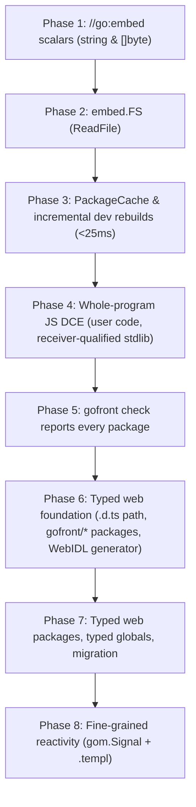

# v2.0.0 Web Platform Evolution — Design Plan

**Version:** v2.0.0  
**Status:** Draft  
**Related:** Builds on [`../v1.9.1/follow-ups-2026-11-10-plan.md`](../v1.9.1/follow-ups-2026-11-10-plan.md) and [`../v1.9.1/follow-ups-2026-11-12-plan.md`](../v1.9.1/follow-ups-2026-11-12-plan.md). Referenced by [`test-harness-hardening-plan.md`](test-harness-hardening-plan.md) (Phase 3 `PackageCache`: shared immutable `stdlibCache`), [`../v1.9.2/release-bundle-fixes-plan.md`](../v1.9.2/release-bundle-fixes-plan.md) (Phase 4 DCE: deferred size work), [`checker-strictness-plan.md`](checker-strictness-plan.md) (merges before Phase 6; Task 3.1 owns its import cycles S22; Phase 7 ends its D3 permissiveness for the typed globals) and [`../v1.9.3/js-codegen-fixes-plan.md`](../v1.9.3/js-codegen-fixes-plan.md) (Task 3.1: import cycles and diamonds; Task 4.5: duplicate runtime helpers; Phase 7 retypes `BROWSER_GLOBALS` but not the `shadowsJsGlobal` rename set); keep those phase and task numbers stable.  
**Release note:** GoFront 2.0 embeds files into the bundle at compile time with `//go:embed`, rebuilds in a fraction of the time in `gofront dev`, leaves unused code out of the JavaScript bundle, and type-checks the browser APIs (DOM, Canvas, Fetch, WebSocket, WebGPU) instead of treating them as `any`. `gofront check` reports every failing package and test file in one run and reports an import cycle as an error instead of crashing, and `.templ` text and attributes bound to a `gom.Signal` update in place. **Breaking:** `document`, `window` and the other browser globals are typed, so reading a property that only a specific element type has needs a type assertion first (see the migration guide); the built-in `GPUDevice`, `GPUQueue` and `GPUAdapter` are replaced by the types in `gofront/webgpu`.

---

## Goal

Transform GoFront from a Go-to-JS/WASM transpile pipeline into a complete, modern web application and reactive UI framework without compromising the pure Node.js ESM compiler architecture or violating the foundational **"No Runtime"** principle (no concurrency scheduler, no runtime reflection, no garbage-collected runtime threads).

v2.0.0 is a major release and **backward compatibility is explicitly not a goal** (user decision 2026-11-13): it may break source that compiled on 1.x when that removes a class of problem. Motivating consumer: SimpleFPS' 1.9.2 adoption (`seriva/simplefps`, archived `gofront-v1.9-adoption-plan.md`), where the stricter `any` rule forced hand-written `.d.ts` interfaces for every DOM and WebGPU value, and the built-in structural `GPUDevice` check (`x.(GPUDevice)` wants `createBuffer` *and* `CreateBuffer` + 7 more pairs, so it rejects a standard device) forced a repo-local `WebGPUDevice`.

v2.0.0 delivers six high-impact capabilities executed in strict dependency order:
1. **`//go:embed` asset and shader inlining:** Embed files directly into compiled bundles as `string`, `[]byte`, or `embed.FS` (`ReadFile`) with zero runtime network fetch requests.
2. **Instant incremental compilation in `gofront dev`:** Sub-25ms file-save rebuilds for JS packages via a process-lifetime cache of immutable compiled packages (user and Go-source stdlib) and package-level invalidation.
3. **Whole-program dead-code elimination (DCE):** Reachability analysis on user code to prune uncalled functions, unused struct methods, and unreferenced types from JS bundles before codegen, plus receiver-qualified method reachability for the Go-source stdlib (it is method-level by name today).
4. **Fully typed web platform:** Remove `any` from the Web API globals (`document`, `window`, `navigator`, `location`, `performance`, `crypto`, `fetch`, timers, …) and ship typed declaration packages under `stdlib/gofront/` for DOM, Canvas, Fetch, WebSocket and WebGPU. They are generated from WebIDL (`@webref/idl`) as `.d.ts`-form declarations and loaded through the existing `.d.ts` path (pass-through assertions, closed member checks), with JS camelCase member names (user decisions 2026-11-13). The hand-built `GPUDevice`/`GPUQueue`/`GPUAdapter` in `src/typechecker/stdlib/web.js` are replaced by the typed package.
5. **Reporting every error in one `gofront check`:** `gofront check <pattern>` reports errors from all packages and their `_test.go` files in one run (`gofront test <pattern>` already does).
6. **Fine-grained reactivity (`gom.Signal` + `.templ`):** Surgical, SolidJS-tier DOM text and attribute updates directly driven by signals in `.templ` templates—zero virtual DOM, zero diffing overhead.

**Done means:**
- `//go:embed` compiles a file into a JS string literal or `Uint8Array` and, on `wasm`/`both`, into a string-table entry (`string`) or a passive data segment read with `array.new_data` (`[]byte`): `test/unit/compiler/embed-js.test.js`, `test/unit/compiler/embed-wasm.test.js`, `test/unit/wasm/data-section.test.js`. Invalid directives (wrong variable type, pattern escaping the package directory, no match, missing `embed` import) are compile errors with the messages in *Edge Cases* (`test/unit/compiler/embed-resolve.test.js`, `test/unit/types/embed-check.test.js`).
- `embed.FS.ReadFile` returns the bytes of files matched by file, glob and directory patterns on `js`, `wasm` and `both` (`test/unit/stdlib/embed-fs.test.js`, `test/unit/compiler/embed-glob.test.js`).
- A warm `gofront dev` rebuild after a one-file edit re-checks and re-emits only the edited package and its importers and no Go-source stdlib package (cache counters asserted in `test/unit/cli/incremental-build.test.js`), produces output byte-identical to a cold build (`test/unit/compiler/package-cache.test.js`), and takes < 25 ms median for `example/gom` and `example/simple` on the JS target (`test/perf/dev-rebuild.js`; 157 ms and 196 ms today).
- An import cycle is a compile error naming the import path instead of a stack overflow, and a package imported by several packages is compiled once per build (`test/unit/compiler/import-cycles.test.js`).
- Each runtime helper is defined once per JS bundle instead of once per package chunk (`test/unit/compiler/shared-helpers.test.js`).
- Unused user functions, types and unselected methods are absent from emitted JS (`test/unit/compiler/dce-funcs.test.js`, `test/unit/compiler/dce-methods.test.js`) and every `example/*` and unit-suite program prints the same output as before.
- Stdlib method reachability is receiver-qualified: a user method named `Len` no longer keeps `strings.Builder.Len` (`test/unit/compiler/dce-stdlib-methods.test.js`). Every budget in `test/perf/bundle-size.baseline.json` is re-measured, none is above its 1.9.2 value, and the numbers are recorded in this plan.
- `gofront check app/src/...` reports every failing package and `_test.go` file in one run and exits non-zero (`test/unit/cli/check-all-packages.test.js`).
- DOM, Canvas, Fetch, WebSocket and WebGPU code type-checks against generated declarations; `document`, `window` and the other Web API globals are no longer `any`; a misspelled member is a compile error; `x.(webgpu.Device)` is a pass-through that accepts a standard device (`test/unit/stdlib/dom-typed.test.js`, `web-apis-typed.test.js`, `webgpu-typed.test.js`, `test/unit/types/browser-globals.test.js`). All `example/*` build and their E2E specs pass.
- `.templ` text and attribute expressions that read a `gom.Signal` update their DOM node on `.Set()` without remounting (`test/unit/builtins/gom-signals.test.js`, `test/unit/compiler/templ-reactive-text.test.js`, `test/unit/compiler/templ-reactive-attr.test.js`, `test/e2e/templ.spec.js`).
- `docs/` describes `//go:embed`, the typed web packages (with a migration section) and `gom.Signal`; `CHANGELOG.md` has the release entry and a `**Breaking:**` entry.
- All existing unit and E2E (`npm run test:e2e`) tests and the perf gates in `npm test` pass.

---

## Scope Rule & Boundary Matrix

| Category | Rule | Examples / Members | Reason (Excluded rows) |
|---|---|---|---|
| **In scope: core** | Asset embedding, incremental watch compilation, DCE (user code; receiver-qualified stdlib methods), typed web platform (globals + packages), all-package `check`, and UI signals | `//go:embed`, `embed.FS.ReadFile`, `PackageCache`, reachability DCE, typed `document`/`window`, `gofront/dom`, `gofront/webgpu`, `gom.Signal` | Core capabilities of the v2.0.0 web platform milestone |
| **In scope: target-specific** | Target-specific asset representation; typed web packages and `.templ` reactivity are `js` only (clear error in `wasm`/`both` packages) | JS: string literals / base64-decoded `Uint8Array` / reactive effect closures. WASM: string table entry (`string`), passive data segment via `array.new_data` (`[]byte`) | Idiomatic platform and backend mapping |
| **Excluded: runtime / platform** | Concurrency scheduler, raw memory access, runtime reflection | Goroutines, channels, `select`, `unsafe.Pointer` to host memory, full `reflect` package | Strict adherence to the GoFront "No Runtime" architectural invariant |
| **Excluded: deferred** | Server-side rendering (SSR) hydration, multi-tab broadcast state, Web Worker RPC | `.templ` HTML stream hydration, `SharedWorker`, Web Worker message passing | Deferred to v2.1+; client-side signals, DOM reactivity, and compiler DX take precedence |
| **Excluded: deferred** | `embed.FS` beyond `ReadFile` | `ReadDir`, `Open`, `fs.FS`, package `io/fs` | `io/fs` is an excluded package (`excluded.js:96`) and enumeration needs its own design; `ReadDir`/`Open` get a targeted diagnostic (user decision 2026-11-13) |
| **Excluded: deferred** | Shrinking the `fmt` hello world | `fmt` call-site specialization, runtime-helper slimming | `Println` reaches `printArg` → `fmtFloat` → `strconv` through real call edges, so reachability cannot remove them (*Verified Gaps*, Stdlib footprint); needs per-call-site specialization (user decision 2026-11-13) |
| **Excluded: deferred** | Web typing outside WebIDL | ECMAScript built-ins in `BROWSER_GLOBALS` (`Math`, `JSON`, `Date`, `RegExp`, `Promise`, `Error`, `Symbol`, `String`, `Number`, `Boolean`, `Array`, `Object`, `parseInt`, `parseFloat`, `isNaN`, `isFinite`, `encodeURIComponent`, `decodeURIComponent`); the hand-built WebGL contexts and typed arrays in `web.js`; PascalCase aliases on the new types | ES built-ins are not defined in WebIDL and stay `any`; WebGL and typed arrays keep their current types and aliases (`example/webgl` uses them); new types use JS camelCase names only (user decision 2026-11-13) |
| **Excluded: deferred** | Reactive `.templ` structure | Signal-driven `if`/`for`/`switch` blocks, reactive component arguments, reactive `@templ.Raw` | Needs block remount and keyed-list design; v2.0.0 binds text and attribute expressions only |

---

## Verified Gaps & Baseline Audit

| Area | Finding | Evidence & Probe Reference |
|---|---|---|
| Embed directive lexing | Lexer recognizes `//go:embed` comment prefix but discards file patterns | `src/lexer/lexer.js:211`: pushes only `{ line, col }` to `this.embedDirectives`; argument string is never captured |
| Embed typechecking | `//go:embed` is hard-coded as unsupported and package `embed` is excluded | `src/typechecker/index.js:463`: `this.err("//go:embed is not supported yet")`; `src/typechecker/stdlib/excluded.js:49`: `"embed"` in `EXCLUDED_STDLIB_PACKAGES` (group `deferred`). Probe (review 2026-11-13): `import _ "embed"` + `//go:embed asset.txt` + `var text string` → `//go:embed is not supported yet` and `package 'embed' is not available: deferred; open an issue if you need it`, so the import Go requires must be accepted in the same phase as the directive |
| WASM data section encoding | `src/backend/wasm/encode.js` has no support for Wasm Section 11 (Data) or Section 12 (DataCount) | `src/backend/wasm/encode.js:1018-1060`: `encodeModule` emits type, import, function, memory, tag, global, export, start, element and code sections only; the GC opcode table (`:380-382`) has `array.new`, `array.new_default`, `array.new_fixed` but no `array.new_data`; `src/backend/wasm/wat.js` (`--emit-wat`) prints no data segments. WASM strings are host strings from the module string table (`internString`, `src/backend/wasm/module-emitter.js:989`), so an embedded `string` needs no data segment; only `[]byte` needs a passive segment + `array.new_data` |
| Watch rebuild latency | Dev server re-runs `runCompile` for the whole program on every save; only the per-file parse cache survives between builds | `src/cli/cli-core.js:1171-1186`: `runDevBuild` calls `runCompile` from scratch. Probe (review 2026-11-13, in-process `runCompile(src, true, { sourceMap: true })`, one file's mtime bumped per build, average of 4 warm builds): `simple` 196 ms, `gom` 157 ms, `templ` 155 ms, `hybrid` 416 ms. V8 sampling profile of a warm `gom` rebuild (self time): `backend/js` 26 ms, `lower/*` 27 ms (`walk` 16, `bounds` 6, `reachability` 5), `typechecker/*` 30 ms, lexer + parser 15 ms, `link/stdlib.js` 8 ms, GC/other 28 ms |
| Stdlib recompiled per build | `gom` has one user package, so nearly all of its 157 ms is the Go-source stdlib being re-lexed, re-checked, re-lowered and re-emitted. Package-level invalidation of user code alone cannot reach 25 ms | `_parseCache` is an LRU of 16 files (`src/compiler.js:64-112`, `PARSE_CACHE_LIMIT`), so stdlib sources are evicted; `stdlibCache` is created per root compile (`src/compiler.js:444`: `options.stdlibCache ?? new Map()`). Sharing it across compiles cuts a `json` compile from 254 ms to 6 ms but ≥ 4 unit tests fail because later passes mutate cached packages (`test-harness-hardening-plan.md` G7, which defers that fix to this plan's Phase 3). `createSrcWatcher` (`src/cli/cli-core.js:1220-1230`) only reacts to `.css`, `.go` and `.templ` |
| AST cache invalidation | ASTs in `_parseCache` are mutated during typechecking and lowering, preventing cross-build reuse | `src/compiler.js:656`: `mangleLocalTypes` deletes ASTs from `_parseCache`; `plans/v1.9.1/follow-ups-2026-11-10-plan.md:109` confirms AST cloning was rejected |
| User-code DCE in JS | `src/lower/reachability.js` (`StdlibReach`) only indexes stdlib declarations; unused user functions, types and methods are fully emitted | `src/link/stdlib.js:472` and `src/link/wasm.js:70,137`: `reachableStdlibDecls` only filters `stdlibPrograms`. Probe (review 2026-11-13): `main` calling only `(*Box).Used`, next to `func UnusedUserFunction`, `(*Box).UnusedMethod` and `type UnusedType` with a method; `gofront <dir> -o out.js` → all three emitted, `UnusedMethod` also listed in `Box.__pm` and `Hello` in `UnusedType.__vm` (`src/backend/js/index.js:1060-1070`) |
| DCE roots | Output has no `export` statements and no `//gofront:export` directive exists (0 hits in `src/`, `docs/`); a package without `main` emits everything today. `__pm`/`__vm` are read at runtime by interface assertions (`src/backend/js/expressions.js:1902`, `src/backend/js/runtime.js:399`); templ output calls `.Mount(...)` without an AST selector (`src/backend/js/templ.js:100,121`) | Probe (review 2026-11-13): `package lib` with `NewGreeter`, `(*Greeter).Greet` and unexported `helper`, no `main` → all emitted, no `export` line. Roots therefore cannot be "`main` + `//gofront:export`" only |
| Migration surface of typed globals | Values read from browser globals flow into concrete types unchecked today, so typing the globals newly checks every member chain; this is wider than the "`any` → concrete needs an assertion" rule, which only fires for a source-declared `any` operand | `_checkIfaceToConcrete` (`src/typechecker/assignability.js:507`) returns early unless `source._declared`. Probe (review 2026-11-13): `var title string = document.title`, `var w int = window.innerWidth`, `if window == nil {…}` and, with `c` a parameter declared `any`, `var w int = c.width` all compile. Uses in `example/*/src`: `document.` 29, `localStorage.` 8, `JSON.` 7, `requestAnimationFrame(` 4, `fetch(` 1; Go-source stdlib files touching host globals: `stdlib/gom/gom.go`, `stdlib/crypto/rand/rand.go`, `stdlib/math/math.go`, `stdlib/regexp/regexp.go` |
| Browser globals typing | `BROWSER_GLOBALS` (`src/typechecker/types.js:43`) lists `console`, `document`, `window`, `navigator`, `location`, `history`, `screen`, `performance`, `crypto`, `fetch`, timers, `Math`, `JSON`, … all defined as `ANY` (`for (const g of BROWSER_GLOBALS) globals.define(g, ANY);`); the 1.9 checker rejects a declared `any` → concrete or `.d.ts` interface without an assertion, so consumers hand-write `.d.ts` interfaces (SimpleFPS: `UIElement`, `UIEvent`, `WebGPUDevice`, …) | `src/typechecker/stdlib/index.js:13`; `src/typechecker/types.js:43-103`; SimpleFPS Phase 1 (PRs #64–#66) |
| Built-in WebGPU types | `GPUQueue`, `GPUDevice`, `GPUAdapter` are hand-built structural types; `x.(GPUDevice)` compiles to a runtime check needing both lower- and upper-case method names, so every standard device fails it. The built-ins are open (`_isOpen: true`, `src/typechecker/resolve.js:1261`), so a misspelled member types as `any`. SimpleFPS reported on 1.9.1 that redeclaring `GPUDevice` in a `.d.ts` does not help (the built-in wins); not reproduced on 1.9.2 in a single package, where the `.d.ts` declaration wins. Other WebGPU types (`GPUBuffer`, `GPUCanvasContext`, …) only exist as consumer `.d.ts` interfaces | `src/typechecker/stdlib/web.js:299-333` (`createWebGPUMethods` registers each method under both names), `:404-445`; SimpleFPS `rendering/backend.go`, `interop.d.ts`. Probe (review 2026-11-13): `dev := raw.(GPUDevice)` → `raw != null && typeof raw.CreateBuffer === "function" && … && typeof raw.createBuffer === "function" && …`; with `interface GPUDevice { configure(cfg: any): void }` imported through `js:./interop.d.ts` the same line emits `let dev = raw;` |
| `.d.ts` path today | A `.d.ts` interface already has the semantics the typed platform needs (pass-through assertion, closed members, properties) but lacks inheritance, optional parameters, dictionary arguments and integer types | Probe (review 2026-11-13): `ctx := raw.(MyCanvasContext)` → `let ctx = raw;`; `ctx.confgure(nil)` → `No member 'confgure' in namespace MyCanvasContext`. `interface Child extends Base` → `No member 'id' in namespace Child` and `Cannot assign Child to Base`; `declare function opt(a: number, b?: number)` called as `opt(1)` → `Too few arguments: expected 2, got 1`; `make(map[string]any{"size": 4})` and `make(desc{size: 4})` against `interface Desc` → `Cannot assign map[string]any to Desc` / `Cannot assign desc to Desc` (`make(nil)` compiles); `number` is always `float64` (`src/dts-parser.js:16-18`); several of these errors carry no line:col |
| Web member naming | Everything uses JS camelCase names; PascalCase aliases exist only for the hand-built WebGL/WebGPU types | `WEB_PASCAL_ALIAS_TYPES` and `_jsMemberName` (`src/backend/js/expressions.js:368,1419-1431`); `example/*`, `stdlib/gom/gom.go` and every `.d.ts` use `document.getElementById`-style names |
| Generator inputs | None of `@webref/idl`, `webidl2`, `typescript`, `@webgpu/types` is installed | `ls node_modules/{@webref/idl,webidl2,typescript,@webgpu/types}` → all missing; `@webref/idl` + `webidl2` become devDependencies (user decision 2026-11-13) |
| `check` stops early | `handleCheck` loops over package dirs and `runCompile` throws on the first failing package, so later packages' errors only appear after fixing earlier ones; test files are not compiled by `check`. `gofront test <pattern>` already reports every failing package including its test files | `src/cli/cli-core.js:572-590`; `_test.go` is filtered out of non-test builds (`src/cli/cli-core.js:497`). Probe (review 2026-11-13): packages `a` and `b`, each with one type error in `x.go` and one in `x_test.go`: `gofront check multi/...` prints only `a.go`'s errors; `gofront check multi/b` prints `b.go`'s but not `b_test.go`'s; `gofront test multi/...` prints `FAIL a [build failed]` and `FAIL b [build failed]` with all six errors |
| Stdlib reachability precision | Stdlib reachability is already method-level, but by name only: one global set of selected names plus `IMPLICIT_METHODS` decides for every reached type, so a user method name keeps the same-named stdlib methods | `src/lower/reachability.js:16-29` (`IMPLICIT_METHODS`), `:128-130` (`names.has(m.recv) && fields.has(m.decl.name)`). Probe (review 2026-11-13): `strings.Builder` with only `WriteString` + `String` → class emits `copyCheck String Write WriteString` (no `Len`, `Reset`, `Grow`, `Cap`, `WriteByte`, `WriteRune`), 17,428 B; adding a user type with `Len()` and `Reset()` that `main` calls → `Builder` also emits `Len` and `Reset`, 23,286 B |
| Stdlib footprint | `fmt.Println` hello world 24 kB (1.8.0) → 176 kB (1.9.1); SimpleFPS release `app.js` 835,581 → 1,117,919 B, ≈ +142 kB from stdlib (`strconv` +44 kB, `fmt` +38 kB). The hello world is large because of real call edges and runtime helpers, not unpruned methods, so reachability cannot recover it (*Excluded: deferred*) | `test/perf/bundle-size.baseline.json`: `fmt-println` 176,939. Probe (review 2026-11-13, unminified `fmt.Println("hello")`, 248,126 B): runtime helpers 108 kB (75 helpers, already emitted on demand: `_helpers`, `src/backend/js/index.js:647-662`), `strconv` 64 kB (90 declarations), `fmt` 51 kB; `pp` keeps `doPrintln printArg fmtFloat fmtComplex printStruct printMap …` because `Println` → `printArg` switches over every dynamic type and reaches `strconv.genericFtoa`, `decimal`, `isPrint32`. GoFront `plans/v1.9.2/release-bundle-fixes-plan.md` *Excluded: deferred* |
| Templ reactivity | Templ codegen emits static one-time mounts with no update mechanism; `gom` has no signals and no unmount or dispose hook | `src/backend/js/templ.js:86-89, 166-181`: text expressions emit `document.createTextNode(String(expr))`; `expr` attributes emit `className = …` / `setAttribute(name, String(expr))`; `cond-bool` attributes (`name?={ expr }`) emit `if (expr) setAttribute(name, "")`, a boolean attribute, so there is no class-toggle syntax. `stdlib/gom/gom.go`: `Node` has only `Mount(parent any, refs any)` (`:12-14`); `gom.Mount` clears `innerHTML` and mounts again (`:126-130`), which is how the examples re-render (`example/gom/src/render.go:197`, `example/templ/src/render.go:81`) |

---

## Approach

### 1. Architecture & Design Decisions



Hard dependencies: 2 → 1; 3 → 2 (embedded files are cache inputs and watch targets); 4 → 3 (pruning must keep the cache valid); 7 → 6; 8 → 7 (`gom.go` is migrated in Phase 7). Phase 5 is independent and sits here to keep Phase 3 and Phase 4 at the numbers other plans cite. Across plans: `checker-strictness-plan.md` merges before Phase 6 (Phase 6 extends assignability; Phase 7 turns `any` DOM values into typed ones), and is independent of Phases 1–5.

#### Subsystem 1: `//go:embed` Asset Inlining (Phases 1 & 2)
- **Directive parsing:** In `src/lexer/lexer.js`, parse `//go:embed <pattern...>` comments into structured directive tokens `{ line, col, patterns: string[] }`; patterns are space-separated and each is bare, double-quoted or back-quoted (Go syntax). In `src/parser/declarations.js`, attach preceding embed directives to subsequent package-level `VarDecl` nodes.
- **Import rule:** As in Go, a file that uses `//go:embed` must import `embed` (`import _ "embed"` for `string`/`[]byte`). Phase 1 therefore removes `embed` from `EXCLUDED_STDLIB_PACKAGES` and adds `stdlib/embed/embed.go` (package clause only until Phase 2).
- **Path resolution & security:** `src/compiler.js` resolves patterns before type-checking, relative to the directory containing the source `.go` file, and attaches `{ path, bytes }[]` to the directive (the type checker never reads files). Go's rules apply: no `.` or `..` elements, no leading or trailing slash, no absolute paths, no backslashes. Containment is checked on the real path with `relative()` + `isAbsolute()` (not `startsWith`, the v1.2.1 dev-server traversal bug), so a symlink that leaves the package directory is rejected.
- **Lowering:** `src/lower/globals.js` turns an embed `VarDecl` into an initializer node `EmbedData { files, as: "string" | "bytes" | "fs" }`, so both backends handle one node kind (pipeline rule: every stage is touched).
- **JS Codegen:**
  - `string`: Emit a JS string literal. A file that is not valid UTF-8 uses the existing raw-byte representation (lone surrogates U+DC80–U+DCFF, as `\xNN` escapes do, see `HELPER_U8ENC` in `src/backend/js/runtime.js`) so `[]byte(s)` round-trips.
  - `[]byte`: Emit a `Uint8Array` decoded once at package init from a base64 literal (a byte-array literal is about 4× larger); the decoder is an on-demand runtime helper.
  - `embed.FS`: Emit a structured in-memory table mapping normalized paths to contents, backed by `stdlib/embed/embed.go`.
- **WASM Codegen:**
  - Add Section 12 (DataCount, before the code section) and Section 11 (Data, after it) to `src/backend/wasm/encode.js`, `array.new_data` to its GC opcode table, and data segments to `src/backend/wasm/wat.js`.
  - For `[]byte` in WASM, store raw bytes into a passive data segment. Emit WasmGC `array.new_data $array_byte $data_idx` followed by slice header construction. This maintains WasmGC struct compatibility with zero linear-memory overhead.
  - For `string` in WASM, intern the content in the module string table (`internString`); no data segment.
  - Units are linked at AST level into one module (`src/link/wasm.js`), so segment indexes need no relocation.

#### Subsystem 2: Incremental Watch Compilation (Phase 3)
- **Dependency graph:** Construct a package-level DAG tracking direct and transitive package imports.
- **Import cycles and diamonds (from `checker-strictness-plan.md` S22 and `../v1.9.3/js-codegen-fixes-plan.md`):** today an import cycle overflows the stack (`gofront check` → `Maximum call stack size exceeded`) because `resolveImports` (`src/compiler.js:173`) recurses with no in-progress set, and each diamond layer doubles compile time because a shared dependency is compiled once per importer. Building the DAG detects a cycle before any package is checked and reports Go's `import cycle not allowed` with the path (`a imports b imports a`) at the first import of the cycle; each package is compiled once per build however many packages import it.
- **Cache architecture:** Introduce `PackageCache` in `src/compiler.js`. It lives for the process (dev server, unit-test workers) and holds user packages and Go-source stdlib packages, replacing the per-compile `stdlibCache` default (`src/compiler.js:444`), which is where most of a warm rebuild goes today. Each compilation unit caches:
  1. Parsed file ASTs with unmutated baseline shapes.
  2. Exported package symbol and type summaries (hashed, to tell importers whether they must be re-checked).
  3. Lowered programs and emitted JS per top-level declaration, so Phase 4 pruning selects declarations without re-emitting (the shape `stdlibJs` + the marker splice in `src/link/stdlib.js` already use).
- **Immutability:** A stored unit is never written by a later build. Passes that rewrite in place today (`mangleLocalTypes`/`renameLocalTypes` at `src/compiler.js:648-656`, array-length folding in `_resolveArrayTypeNode`, lowering) run before the unit is stored or write to per-build side tables. Tests deep-freeze stored units to find violations. This is the fix `test-harness-hardening-plan.md` G7 defers here.
- **Cache key:** per package: path + mtime + size of every source file, of its `js:` `.d.ts` imports and of its embedded files; the resolved target; and the options that change output (`sourceMap`, `forceTarget`, `targetOverrides`, natives on/off). A failed compile is never stored.
- **Granular invalidation:** In `src/cli/cli-core.js` and `src/cli/dev-server.js`:
  - When `file.go` changes, invalidate only its package and packages directly or indirectly importing it.
  - If a file modification does not alter exported types or signatures, dependent packages reuse their cached type summaries.
  - Watcher adds embedded asset files and `.d.ts` files to the watch list so their changes trigger rebuilds (`createSrcWatcher` reacts to `.css`, `.go` and `.templ` only today).
- **Budget:** deterministic cache counters are asserted in unit tests; the 25 ms figure is asserted by `test/perf/dev-rebuild.js` (median of 20 warm rebuilds, part of `npm run bench`, not `npm test`, so slow CI machines do not flake).

#### Subsystem 3: Whole-Program Dead-Code Elimination (Phase 4)
- **Reachability traversal:** Generalize `StdlibReach` in `src/lower/reachability.js` beyond `stdlibPrograms` to one closure over user and stdlib programs.
- **Roots:** Mark as roots:
  1. `main()` in the entry package. When the entry package has no `main` (library build, `gofront <dir> -o`), every exported declaration of the entry package.
  2. The generated test main under `gofront test` (`testDriverProgram`, `src/compiler.js:630`), which references every test and benchmark function.
  3. Exported functions, methods and types of `wasm` packages reached through the boundary facade (`wasmExportedSignatures`, `src/link/stdlib.js`), as today. There is no `//gofront:export` directive.
  4. `init()` functions and package-level variable initializers with side effects of every imported user package (Go runs them even when nothing else is used); the stdlib keeps its current rule (a program's `init` is kept when anything else in it is reached).
  5. Implicit runtime/formatter methods (`IMPLICIT_METHODS`: `String()`, `Error()`, `MarshalJSON()`, …) and methods the JS backend calls in emitted code without an AST selector (templ `Mount`).
  6. Declarations referenced by generated code (`src/lower/json-codecs.js`, `fmt-formatters.js`, `errors-as.js`): reachability runs after those passes or takes their output as roots.
  7. JS escape: when a value of a user type flows into an external declaration (argument or assigned property of a `.d.ts` or typed-web function or value), every method of that type is kept, because JavaScript calls them by name.
- **Interface dispatch:** The existing rule stays: a method named by a reached interface type is kept on every reached type.
- **Receiver-qualified selection:** Stdlib reachability is method-level by name today. Record selected method names per static receiver type when the receiver is a concrete named type; selections through interface, type-parameter or `any` receivers and `IMPLICIT_METHODS` stay name-global. This removes the cross-talk the probe shows (a user `Len` keeping `strings.Builder.Len`). It does not shrink the `fmt.Println` hello world, whose size comes from real call edges (*Excluded: deferred*).
- **Pruning:** Prune unreached `FuncDecl`s, unreferenced struct types, and uncalled methods before JS codegen by filtering declarations, as `stdlibJs` does (`decls.filter((d) => reached.has(d))`).
- **JS Class Methods:** For struct types that are retained, omit uncalled methods from the generated ES6 `class` definition and from the `__vm` and `__pm` method arrays (`src/backend/js/index.js:1060-1070`).
- **Runtime helpers once per bundle (from `../v1.9.3/js-codegen-fixes-plan.md`):** each package chunk prepends its own copy of every runtime helper it uses (`_prependHelpers`, `src/backend/js/index.js:658`), so a `fmt` hello world carries 286 definitions of 74 helpers. Chunks report their helper set instead, and the bundle emits the union once ahead of the first chunk (`mergeCompilationChunks`, `src/link/sourcemap.js:25`, shifting source-map line offsets accordingly). Cached units (Phase 3) store their helper set next to their emitted JS.
- **Scope:** JS output only (`js` packages and the JS side of `both`). WASM output is unchanged: Binaryen prunes release builds and dev-mode WASM keeps its stdlib reachability.
- **Phase 3 interplay:** Pruning selects among cached per-declaration output; only the closure is recomputed per build (about 5 ms in the profile). `gofront dev` and `gofront build` prune identically, so a pruning bug cannot hide until release.

#### Subsystem 4: Fully Typed Web Platform (Phases 6 & 7)
- **Declaration form (user decision 2026-11-13):** Generated `.d.ts`-form files under `stdlib/gofront/<pkg>/` (`dom`, `canvas`, `fetch`, `websocket`, `webgpu`), loaded through `parseDts` + `checker.addDefinitions` like a consumer's `js:./interop.d.ts`. The existing path already gives the wanted semantics (probe): an assertion to a declared interface is a pass-through, members are closed, properties work, nothing is emitted. Rejected: Go-syntax declarations with a new extern directive (new language surface through every pipeline stage for the same behaviour).
- **`.d.ts` path extensions (Phase 6):** what the probe shows is missing: interface inheritance (`extends`: inherited members visible, derived assignable to base); optional parameters (`b?: T` gives an arity range); `Promise<T>` results (`await` yields `T`; generics collapse to `any` today, `src/dts-parser.js:10-11`); GoFront integer and `float32` type names in declarations (`number` stays `float64`); dictionary arguments (an interface the generator marks as a dictionary accepts `nil`, a `map[string]any` literal whose constant keys are members, and a field-only struct whose fields are members); line:col on member and arity errors. Consumer `.d.ts` files keep their behaviour except for these additions.
- **Packages:** `import "gofront/dom"` resolves to the generated declarations and exposes types as `dom.HTMLInputElement`; typed globals need no import. Declarations load lazily (first import or first use of a typed global) and are parsed once per process, so a program that uses no Web API pays no check time.
- **Generated, not hand-written:** A generator script (`scripts/gen-web-types.js`, run by maintainers, output committed, `--check` mode in `npm run check` like `scripts/gen-pdq.js --check`) reads WebIDL from `@webref/idl` with `webidl2` (devDependencies; user decision 2026-11-13) and writes the declaration files. Nothing is emitted for them at runtime: members compile to native JS property accesses and calls with no wrapper. The spec → package map, renames and hand-tuned fixes live in `scripts/web-types-overrides/` so regeneration is reproducible. The mapping table is fixed and tested in Task 6.5: inheritance → `extends`; mixins and partials merged; every integer IDL type (`byte` … `unsigned long long`) → `int` (sized ints are plain JS numbers in `js` packages, so sized types would only force conversions; `int` keeps `var w int = window.innerWidth` valid under the strict numeric rules of `checker-strictness-plan.md`), `double`/`float` → `float64`/`float32`; `DOMString`/`USVString` → `string`; nullable → nil-able; unions, `any` and `object` → `any`; `sequence<T>` → `[]T`; `Promise<T>` kept; dictionaries → dictionary interfaces; enums → `string`; callbacks and event handlers → `func` types; constants and constructors.
- **Names (user decision 2026-11-13):** Members keep their JS camelCase names (`document.getElementById`), as all existing code and consumer `.d.ts` files do; no PascalCase aliases on generated types. Type names are the WebIDL interface names (`dom.HTMLElement`, `canvas.CanvasRenderingContext2D`, `fetch.Response`), except that `webgpu` drops the `GPU` prefix (`webgpu.Device`, `webgpu.CanvasContext`).
- **Typed globals (breaking):** Every `BROWSER_GLOBALS` entry that WebIDL defines gets its generated type instead of `ANY`: `document`, `window`, `navigator`, `location`, `performance`, `crypto`, `fetch`, timers, `requestAnimationFrame`, `localStorage`, `console`, …. ECMAScript built-ins (`Math`, `JSON`, `Object`, …) stay `any` (*Excluded: deferred*). Migration: member chains on these globals are checked for the first time (they flow into concrete types unchecked today), so a property of a specific element type needs a downcast first: `document.getElementById("q").(dom.HTMLInputElement).value`. `HTMLCanvasElement.getContext` returns a union, so its result is asserted to `canvas.CanvasRenderingContext2D`, `webgpu.CanvasContext` or the existing `WebGL2RenderingContext`. List the common cases in the changelog and `docs/`.
- **Strictness on typed globals (`checker-strictness-plan.md` D3):** that plan keeps arithmetic, calls and member access on JS-dynamic `ANY` permissive until this phase. Once a global is typed, its members are ordinary typed values and every strict rule applies (identical numeric operand types, no implicit `int` → `float64`). What stays `ANY` keeps D3 permissiveness in v2.0.0: ECMAScript built-ins, IDL unions, `any` and `object`, `.d.ts` `any` and the hand-built WebGL tables. The example sites the checker plan left permissive (14 arithmetic sites in 4 files, its S27) are migrated in Task 7.4.
- **Rename set unchanged:** `../v1.9.3/js-codegen-fixes-plan.md` renames user declarations through `shadowsJsGlobal` (`BROWSER_GLOBALS` ∪ `JS_RESERVED_GLOBALS`). Retyping `BROWSER_GLOBALS` changes the types of its entries, never its membership, so the rename set and `test/unit/compiler/js-globals.test.js` are unaffected.
- **Migration order:** Go-source stdlib files and `example/*` are first rewritten to compile under both untyped and typed globals (assertions to declared interfaces are pass-throughs either way), then the globals flip, so every commit builds.
- **Headless-safe:** Typed globals stay comparable to `nil` (`if window == nil`), because packages guard on it to stay testable under `gofront test` without a DOM.
- **WebGPU:** `gofront/webgpu` replaces the hand-built `GPUDevice`/`GPUQueue`/`GPUAdapter` in `web.js` (and their entries in `WEB_PASCAL_ALIAS_TYPES`, `src/backend/js/expressions.js:368`). An assertion to a WebGPU interface is a typed pass-through, never a structural runtime check, so `device.(webgpu.Device)` accepts a standard browser device and a test fake with the same members. The old `GPUDevice`, `GPUQueue` and `GPUAdapter` names are removed outright (no compatibility aliases).
- **Consumer `.d.ts`:** A package's own `interop.d.ts` declarations keep working (they are the escape hatch for libraries such as PeerJS).
- **Callbacks:** Event listener functions take typed parameters (`func(e dom.MouseEvent)`).

#### Subsystem 5: Fine-Grained UI Reactivity (Phase 8)
- **Signals in `gom`:** Introduce `gom.Signal[T]` and `gom.Computed[T]` in a new `stdlib/gom/signals.go`:
  ```go
  count := gom.NewSignal(0)
  count.Set(count.Get() + 1)
  ```
  `Subscribe` returns an unsubscribe function. An internal effect primitive tracks dependencies: `Get` inside a running effect subscribes that effect.
- **Reactive binding in `.templ`:**
  - Enhance `src/backend/js/templ.js`: a text or attribute expression is reactive when it contains a `Get` call on a `gom.Signal`/`gom.Computed` or is itself of signal type, decided from the checked types on the templ expression AST. A reactive expression emits an effect that re-evaluates the whole expression, so compound expressions (`{ fmt.Sprintf("%d items", count.Get()) }`) update too (`___fx` stands for the gom effect primitive):
    ```javascript
    const ___node = document.createTextNode("");
    ___p.appendChild(___node);
    ___fx(function() { ___node.data = String(count.Get()); });
    ```
  - `expr` attributes re-run today's assignment inside the effect (`className = …`, `setAttribute(name, String(…))`). `cond-bool` attributes (`disabled?={ sig.Get() }`) emit `toggleAttribute(name, !!v)`. There is no `class?=` toggle: `name?=` is a boolean attribute, so conditional classes use a `class={ … }` expression.
  - Text and attributes update surgically on `.Set()` without remounting parent elements or running virtual DOM diffs. Non-reactive expressions keep today's output unchanged.
- **Disposal:** Effects created while mounting under `gom.Mount(sel, …)` belong to that root. Mounting the same selector again, which is how the examples re-render, disposes them before `innerHTML` is cleared; otherwise every re-render would leak effects that keep updating detached nodes.

#### Subsystem 6: `gofront check` Reports Everything (Phase 5)
- **Collect, do not throw:** In pattern mode `handleCheck` (`src/cli/cli-core.js:572-590`) compiles every package and records `{ dir, errors }` instead of stopping at the first failure; the exit code is non-zero when any package failed and a per-package summary (`ok` / `FAIL` / `skipped`) follows the errors.
- **Test files:** `check` type-checks the same file set as `gofront test` (including `_test.go`) without running anything, in single-package and pattern mode.
- **Skipped dependents:** A package that imports a failed package is listed as `skipped (<pkg> failed)`; the dependency's errors are printed once.
- **Layering:** Logic and formatting stay in `cli-core.js`; `src/index.js` only prints what they return.

---

### 2. Invariants & Safety Bounds

- **"No Runtime" Invariant:** No goroutines, channels, green-thread scheduler, or GC runtime shims. All reactivity is deterministic publisher-subscriber function closure dispatch in client JavaScript.
- **Dual Target Integrity:** `//go:embed` must function identically on `js`, `wasm`, and `both`. Web APIs and `.templ` reactivity remain strictly checked to `//gofront:target js`.
- **Cache Determinism:** Rebuilding incrementally via `gofront dev` must produce output byte-identical to a clean cold build. Any AST modification must not bleed across rebuild cycles: a unit stored in `PackageCache` is immutable.
- **Dev and release prune alike:** DCE runs in `gofront dev`, `gofront build` and `gofront test`; the reachability closure is recomputed on every build and never becomes part of a cache key.
- **Typed web is free unless used:** Generated declarations emit no runtime code and are not loaded for a program that uses no Web API; assertions to generated interfaces are pass-throughs, so a migrated program emits the same JS as before.
- **Non-reactive templ output is unchanged:** A `.templ` expression that reads no signal compiles to the same JS as on 1.9.2.
- **Zero Runtime Dependencies:** The compiler remains 100% dependency-free pure Node.js ESM. `@webref/idl` and `webidl2` are devDependencies used only by the generator; its output is committed under `stdlib/` (shipped by `package.json` `files`), `scripts/` is not shipped.
- **Layer guard:** Every new `src/**/*.js` and `stdlib/**/*.go` file is covered by a layer glob in `.sentrux/rules.toml` (`scripts/check-layers.js` fails otherwise); `stdlib/embed/` needs a new entry.
- **Stable phase numbers:** Phase 3 stays the `PackageCache` phase with Task 3.1 the dependency DAG, Phase 4 the DCE phase with Task 4.5 the shared runtime helpers, and Phases 6 and 7 the typed web phases (cited by `test-harness-hardening-plan.md`, `../v1.9.2/release-bundle-fixes-plan.md`, `checker-strictness-plan.md` and `../v1.9.3/js-codegen-fixes-plan.md`).

---

### 3. Edge Cases & Error Handling

- **Embed Path Traversal:** Reject `//go:embed ../secrets.env`, absolute paths, paths with `\`, and symlinks that resolve outside the package directory with `embed pattern escapes package directory`.
- **Unmatched Embed Patterns:** If an embed glob matches zero files, emit `pattern <pat> matches no files`.
- **Type Mismatch on Embed:** If `//go:embed` precedes a type other than `string`, `[]byte`, or `embed.FS`, report `cannot embed into variable of type <type>`.
- **Misplaced directives (Go's wording):** `go:embed cannot apply to var inside func`, `go:embed cannot apply to multiple vars`, `go:embed cannot apply to var with initializer`, `go:embed only allowed in Go files that import "embed"`; more than one matched file for a `string` or `[]byte` → `multiple files for type <type>`.
- **Glob semantics are Go's:** `*` never crosses `/` (`path.Match`), so `assets/**/*` is not recursive; a directory pattern (`//go:embed assets`) embeds the tree, skipping names that start with `.` or `_` unless the pattern has the `all:` prefix. Matches are sorted so output is deterministic.
- **Embed content:** A `string` embed of a non-UTF-8 file must round-trip through `[]byte(s)`; a `[]byte` embed must preserve all 256 byte values through `--minify --mangle`; `js` and `wasm` output of a `both` package hold the same bytes; a file embedded by two variables is stored once per module.
- **`embed.FS` misses and exclusions:** `ReadFile` of an unknown path returns the error `open <name>: file does not exist` (no `fs.ErrNotExist`: `io/fs` is excluded); `ReadDir` and `Open` are compile errors through `EXCLUDED_STDLIB_MEMBERS`.
- **Import cycles:** Not rejected today: a cycle overflows the stack in `resolveImports`. Task 3.1 reports `import cycle not allowed` with the import path, for a self-import and for a longer cycle, in `gofront check`, `build`, `dev` and `test`; in `gofront dev`, an edit that introduces a cycle reports the error and an edit that removes it rebuilds normally (the failed build is not cached).
- **Cache invalidation corners:** A file added to, removed from or renamed in a package; a changed `.d.ts` or embedded file; a `gofront.json` target change; a build that fails and is then fixed (the failed unit must not be served); two builds with different options sharing one process.
- **DCE Interface Dispatch:** If an interface method is called dynamically (`var r io.Reader; r.Read(...)`), any concrete struct method matching that signature on an instantiated type must be marked reachable.
- **DCE and dynamic use:** Kept as reachable: a method used as a method value or method expression; methods promoted through embedding (`src/lower/embedding.js`); methods of a type that escapes to JavaScript; methods checked by runtime interface assertions (`__vm`/`__pm` must list exactly the emitted methods, so `x.(I)` gives the same answer as before); `Mount` on templ components.
- **DCE entry shapes:** A package without `main` keeps its exported declarations; `gofront test` keeps every test and benchmark through the generated test main; adding or removing the only call to a function in `gofront dev` gives the same output as a cold build.
- **Breaking migration:** Values read from browser globals flow into concrete types unchecked today (`var w int = window.innerWidth` compiles), so typing the globals checks those member chains for the first time. Code breaks where it reads a member the static type does not have (`getElementById("q").value`), relies on a custom property of `window`, or passes a value of the wrong type; the fix is a downcast to the specific interface or a `.d.ts` declaration. `docs/` gets a migration section with before/after examples; the changelog entry is `**Breaking:**` and says what to do.
- **WebGPU fakes in tests:** A test double that implements only some `webgpu.Device` members must still be assertable to the interface; the typed package must not add a runtime member check.
- **Declaration corners:** A dictionary literal with an unknown key or a struct with an unknown field is rejected and names the member; a derived interface is assignable to its base but not the reverse without an assertion; an optional parameter may be omitted but extra arguments are still rejected; importing a `gofront/*` web package from a `wasm` or `both` package is a clear error.
- **`check` over many packages:** One package's error must not hide another's, and a package whose dependency failed to compile is reported as skipped, not as a second error.
- **Signal Disconnect / Leaks:** `gom` has no unmount hook, and re-rendering calls `gom.Mount` on the same selector again. Effects are therefore owned by the mount root and disposed on the next `gom.Mount` of that selector; `Subscribe` returns an unsubscribe function for manual use.
- **Signal corners:** `Set` with an equal value does not notify; an effect that sets a signal it reads must not recurse without bound (panic with a clear message); a `Computed` re-evaluates only when a dependency changed.

---

## Implementation Tasks

### Phase 1: `//go:embed` Scalar Inlining (`string` and `[]byte`)
- [ ] Task 1.1: Lex and parse `//go:embed` directives into AST var declarations
  - Files: `src/lexer/lexer.js`, `src/parser/declarations.js`, `src/parser/index.js`
  - Test: `test/unit/parser/embed-directives.test.js` asserting pattern extraction (bare, double-quoted, back-quoted, several patterns on one line) and AST attachment
  - Done when: `//go:embed asset.txt "b c.txt"` attaches `{ patterns: ["asset.txt", "b c.txt"], line, col }` to the succeeding package-level `VarDecl`; a directive with no such declaration after it stays in `_embedDirectives` for the checker to reject
- [ ] Task 1.2: Resolve embed patterns to files before type-checking
  - Files: `src/compiler.js`
  - Test: `test/unit/compiler/embed-resolve.test.js`, negative cases first: `..`, an absolute path, a backslash and a symlink out of the package directory → `embed pattern escapes package directory`; no match → `pattern <pat> matches no files`
  - Done when: every directive carries `{ path, bytes }[]` resolved relative to its source file's directory, with containment checked by `relative()`/`isAbsolute()` on the real path
- [ ] Task 1.3: Type-check embed variables and accept the `embed` import
  - Files: `src/typechecker/index.js`, `src/typechecker/stdlib/excluded.js`, `stdlib/embed/embed.go`
  - Test: `test/unit/types/embed-check.test.js` asserting `cannot embed into variable of type <type>`, `go:embed cannot apply to var inside func`, `go:embed cannot apply to multiple vars`, `go:embed cannot apply to var with initializer`, `go:embed only allowed in Go files that import "embed"` and `multiple files for type string`
  - Done when: `import _ "embed"` compiles on `js`, `wasm` and `both`; `string` and `[]byte` variables with exactly one matched file pass; `//go:embed is not supported yet` is gone; `.sentrux/rules.toml` covers `stdlib/embed/` (`npm run check:layers`)
- [ ] Task 1.4: Lower and emit embedded scalars in the JS backend
  - Files: `src/lower/globals.js`, `src/backend/js/expressions.js`, `src/backend/js/runtime.js`
  - Test: `test/unit/compiler/embed-js.test.js` asserting string content, `[]byte` content with all 256 byte values, a non-UTF-8 file embedded as `string` round-tripping through `[]byte(s)`, and identical results after `--minify --mangle`
  - Done when: Embedded `string` and `[]byte` variables initialize at package load without runtime network requests; the base64 decoder is emitted only when a `[]byte` embed exists
- [ ] Task 1.5: Add Wasm Data and DataCount sections to Wasm encoder
  - Files: `src/backend/wasm/encode.js`, `src/backend/wasm/module-emitter.js`, `src/backend/wasm/wat.js`
  - Test: `test/unit/wasm/data-section.test.js` asserting Section 12 before the code section, Section 11 after it, passive segment bytes and the `array.new_data` opcode encoding
  - Done when: `WebAssembly.validate` accepts encoded modules containing passive data segments and `--emit-wat` prints them
- [ ] Task 1.6: Emit embedded scalars in the WASM backend
  - Files: `src/backend/wasm/globals.js`, `src/backend/wasm/emit-exprs.js`
  - Test: `test/unit/compiler/embed-wasm.test.js` asserting embedded `[]byte` (via `array.new_data`) and `string` (via the string table) in `wasm` and `both` packages, with the same bytes as the JS output, and a module that still validates after `--wasm-opt` when `binaryen` is installed
  - Done when: A WASM package accessing an embedded `[]byte` correctly reads bytes with zero linear-memory copy

### Phase 2: `embed.FS` Virtual Filesystem Support
- [ ] Task 2.1: Implement `embed.FS` with `ReadFile` in Go source
  - Files: `stdlib/embed/embed.go`, `src/typechecker/stdlib/excluded.js`, `src/typechecker/index.js`
  - Test: `test/unit/stdlib/embed-fs.test.js` asserting `ReadFile` on an in-memory table (hit returns a copy of the bytes; miss returns `open <name>: file does not exist`), and that `ReadDir` and `Open` are compile errors with the `EXCLUDED_STDLIB_MEMBERS` diagnostic
  - Done when: `var files embed.FS` under a directive type-checks (non-blank `import "embed"` required) and `ReadFile` works on `js`, `wasm` and `both`
- [ ] Task 2.2: Implement multi-file glob pattern resolution for `embed.FS`
  - Files: `src/compiler.js`
  - Test: `test/unit/compiler/embed-glob.test.js` asserting `shaders/*.wgsl`, a directory pattern (`assets`, recursive, skipping `.` and `_` names), `all:assets`, `*` not crossing `/`, and sorted results
  - Done when: Globs and directory patterns populate the virtual filesystem map with Go's `embed` semantics
- [ ] Task 2.3: Codegen virtual filesystem manifest for JS and WASM
  - Files: `src/lower/globals.js`, `src/backend/js/expressions.js`, `src/backend/wasm/globals.js`
  - Test: `test/unit/compiler/embed-manifest.test.js` asserting FS lookup by path at runtime and that a file embedded by two variables is stored once
  - Done when: `files.ReadFile("shaders/light.wgsl")` returns file contents on both JS and WASM targets
- [ ] Task 2.4: Integrate embedded asset paths into dev-server watcher
  - Files: `src/cli/cli-core.js`, `src/cli/dev-server.js`
  - Test: `test/unit/cli/dev-server-embed.test.js` asserting that modifying an embedded asset file (any extension) triggers dev reload
  - Done when: Editing `asset.txt` triggers an automatic rebuild in `gofront dev`

### Phase 3: Instant Incremental Compilation in `gofront dev`
- [ ] Task 3.1: Implement `PackageCache` and dependency DAG in compiler
  - Files: `src/compiler.js`, `src/link/stdlib.js`
  - Test: `test/unit/compiler/package-cache.test.js` asserting DAG construction, hit/miss counters, and the cache key: source files (mtime + size), `js:` `.d.ts` imports, embedded files, target and output options; a file added, removed or renamed; a failed compile is not stored. `test/unit/compiler/import-cycles.test.js` asserting a self-import and an `a → b → c → a` cycle give `import cycle not allowed` with the path and line:col (not `Maximum call stack size exceeded`), and that a three-layer diamond compiles each package once (counter)
  - Done when: `PackageCache` holds user and Go-source stdlib units for the life of the process, replaces the per-compile `stdlibCache` default (`src/compiler.js:444`), and exports a reset for tests; import cycles are compile errors and the `t24` program of `checker-strictness-plan.md` S22 reports one
- [ ] Task 3.2: Make cached units immutable across builds
  - Files: `src/compiler.js`, `src/typechecker/resolve.js`, `src/lower/index.js`
  - Test: `test/unit/compiler/ast-reusability.test.js` asserting that two consecutive builds through one cache are byte-identical to two cold builds for programs with function-local types (`mangleLocalTypes`), folded array lengths, `encoding/json` and `fmt`, with stored units deep-frozen under a test flag
  - Done when: No pass writes to a unit after it is stored (typechecker, `mangleLocalTypes`, lowering, backends), and the unit tests that fail with a shared `stdlibCache` (`test-harness-hardening-plan.md` G7) pass with it
- [ ] Task 3.3: Implement incremental package-level rebuild in dev server
  - Files: `src/cli/cli-core.js`, `src/cli/dev-server.js`, `test/perf/dev-rebuild.js`
  - Test: `test/unit/cli/incremental-build.test.js` asserting through cache counters that a one-file edit re-checks only the edited package and the importers whose dependency summary changed, re-checks and re-emits no stdlib unit, and gives output equal to a cold build
  - Done when: The counters hold and `node test/perf/dev-rebuild.js` (median of 20 warm rebuilds, added to `npm run bench`) reports < 25 ms for `example/gom` and `example/simple` on the JS target. If the budget is missed, stop and report the measured number; do not loosen it silently
- [ ] Task 3.4: Preserve and verify source maps across incremental rebuild chunks
  - Files: `src/link/sourcemap.js`, `src/cli/cli-core.js`
  - Test: `test/unit/compiler/incremental-sourcemap.test.js` asserting that the mappings after three incremental edits equal those of a cold build
  - Done when: Browser DevTools correctly map source lines to original `.go` files after multiple incremental saves

### Phase 4: Whole-Program Dead-Code Elimination (DCE) on JS
- [ ] Task 4.1: Extend reachability analysis to user packages with explicit roots
  - Files: `src/lower/reachability.js`, `src/lower/index.js`, `src/link/stdlib.js`
  - Test: `test/unit/compiler/reachability-user.test.js` asserting the reached set for each root kind of Subsystem 3: `main`; exported declarations of an entry package without `main`; the generated test main; `init` and side-effecting initializers of imported packages; wasm facade exports; generated codec and formatter references; the JS-escape rule; templ `Mount`
  - Done when: One closure covers user and stdlib programs and returns the reached declarations; emitted output is still unchanged (nothing is pruned yet)
- [ ] Task 4.2: Prune unreferenced top-level functions, constants, variables and types before JS codegen
  - Files: `src/lower/reachability.js`, `src/backend/js/index.js`
  - Test: `test/unit/compiler/dce-funcs.test.js` asserting `UnusedUserFunction` and `UnusedType` from the Verified Gaps probe are omitted, a package-level `var` with a side-effecting initializer is kept, and a package without `main` keeps its exported declarations; `test/unit/cli/incremental-build.test.js` gains a case where adding and then removing the only call to a function equals a cold build
  - Done when: An uncalled function in a user package does not appear in the emitted `app.js`, and `gofront test` and every `example/*` print the same output as before
- [ ] Task 4.3: Prune uncalled struct methods
  - Files: `src/backend/js/index.js`, `src/lower/reachability.js`
  - Test: `test/unit/compiler/dce-methods.test.js` asserting an unselected method is absent from the class body, `__vm` and `__pm`, and that a method stays when it is named by a reached interface, used as a method value, promoted through embedding, or its type escapes to JavaScript
  - Done when: Methods never called or selected on a struct do not appear in its class body or its `__vm`/`__pm` arrays, and runtime interface assertions give the same results as before
- [ ] Task 4.4: Receiver-qualified method reachability (user code and Go-source stdlib)
  - Files: `src/lower/reachability.js`, `src/link/stdlib.js` (`reachableStdlibDecls`)
  - Test: `test/unit/compiler/dce-stdlib-methods.test.js` asserting the Verified Gaps probe (a user type with `Len`/`Reset` no longer makes `strings.Builder` emit `Len`/`Reset`) and that selections through interface, type-parameter and `any` receivers still keep the method on every reached type
  - Done when: The probe passes with no output differences in the stdlib test suite
- [ ] Task 4.5: Emit each runtime helper once per bundle
  - Files: `src/backend/js/index.js` (`_helpers`, `_prependHelpers`), `src/link/sourcemap.js` (`mergeCompilationChunks`), `src/compiler.js`
  - Test: `test/unit/compiler/shared-helpers.test.js` asserting each helper name is defined once in the bundle of a `fmt` hello world and of a multi-package program (286 definitions of 74 helpers in the hello world on 1.9.2), that a helper only one package uses is still emitted, that source maps of the second chunk still point at the right lines, and that a warm `gofront dev` rebuild gives the same bundle as a cold build
  - Done when: No helper is defined twice in any `example/*` bundle and every `example/*` prints the same output as before
- [ ] Task 4.6: Re-measure and tighten the bundle budgets
  - Files: `test/perf/bundle-size.js`, `test/perf/bundle-size.baseline.json`
  - Test: `node test/perf/bundle-size.js` and `--self-test` with new cases for the user-DCE probe program and each JS `example/*` bundle
  - Done when: Every existing budget is at or below its 1.9.2 value, the new cases have budgets, and the before/after numbers are recorded in this plan under this task

### Phase 5: `gofront check` Reports Every Package and Test File
- [ ] Task 5.1: Collect errors per package in `gofront check <pattern>`
  - Files: `src/cli/cli-core.js` (`handleCheck`)
  - Test: `test/unit/cli/check-all-packages.test.js` with two failing packages: asserts both packages' errors appear in one run, a per-package summary follows, and the exit code is non-zero
  - Done when: `gofront check ./pkg/...` no longer stops at the first failing package
- [ ] Task 5.2: Type-check `_test.go` files in `gofront check`
  - Files: `src/cli/cli-core.js`, `src/cli/test-runner.js`
  - Test: `test/unit/cli/check-all-packages.test.js`: a package whose only error is in `x_test.go` fails `check` in single-package and pattern mode, and no test function runs
  - Done when: `check` compiles the same file set as `gofront test` through a shared helper
- [ ] Task 5.3: Report dependents of a failed package as skipped
  - Files: `src/cli/cli-core.js`
  - Test: `test/unit/cli/check-all-packages.test.js`: `b` imports failing `a` → `a`'s errors are printed once and `b` is listed as `skipped (a failed)`
  - Done when: One package's error never hides another's and no error is reported twice

### Phase 6: Typed Web Foundation (`.d.ts` path, `gofront/*` packages, WebIDL generator)
- [ ] Task 6.1: Interface inheritance in the `.d.ts` path
  - Files: `src/dts-parser.js`, `src/typechecker/assignability.js`
  - Test: `test/unit/types/dts-extends.test.js` asserting the Verified Gaps probe: a member inherited through `interface Child extends Base` resolves (also over two levels), `Child` is assignable to `Base`, `Base` to `Child` needs an assertion that compiles to a pass-through, and member errors carry line:col
  - Done when: `No member 'id' in namespace Child` and `Cannot assign Child to Base` from the probe are gone and existing `.d.ts` tests pass unchanged
- [ ] Task 6.2: Optional parameters, `Promise<T>` results and integer types in declarations
  - Files: `src/dts-parser.js`, `src/typechecker/expressions.js`
  - Test: `test/unit/types/dts-optional.test.js` asserting `opt(1)` and `opt(1, 2)` compile for `opt(a: number, b?: number)`, `opt()` → `Too few arguments`, `opt(1, 2, 3)` → too many; `await` on a `Promise<Response>` result is typed `Response`; `int`, `uint32` and `float32` are accepted as declaration types
  - Done when: The probe's `Too few arguments: expected 2, got 1` is gone and arity errors carry line:col
- [ ] Task 6.3: Dictionary arguments
  - Files: `src/dts-parser.js`, `src/typechecker/assignability.js`
  - Test: `test/unit/types/dts-dictionary.test.js` asserting that a parameter of a dictionary interface accepts `nil`, a `map[string]any` literal with member keys and a field-only struct; an unknown key or field is an error that names it; a basic-typed member rejects a value of the wrong type; an interface not marked as a dictionary behaves as today
  - Done when: The probe's `Cannot assign map[string]any to Desc` and `Cannot assign desc to Desc` are gone for marked dictionaries; the marker syntax is documented in `src/dts-parser.js`
- [ ] Task 6.4: Resolve `gofront/*` declaration packages with lazy loading
  - Files: `src/compiler.js`, `src/typechecker/index.js`, `src/typechecker/types.js`
  - Test: `test/unit/compiler/web-packages.test.js` with a small fixture declaration directory (through `options.stdlibRoot`) asserting `import "gofront/dom"` exposes `dom.T`, an import from a `wasm` or `both` package is a clear error, an unknown `gofront/x` keeps the existing unsupported-package error, and a `println`-only program loads no declaration file (load counter)
  - Done when: Declarations are parsed at most once per process and only when imported or when a typed global is used
- [ ] Task 6.5: Add the web-types generator
  - Files: `scripts/gen-web-types.js`, `scripts/web-types-overrides/`, `package.json`
  - Test: `test/unit/cli/gen-web-types.test.js` asserting deterministic output for a small IDL fixture (inheritance, mixin, partial interface, optional and nullable members, union, dictionary, enum, callback, `Promise`, constant, constructor)
  - Done when: `@webref/idl` and `webidl2` are pinned devDependencies; running the generator twice produces byte-identical declaration files; `npm run check` runs `gen-web-types.js --check`; the mapping table of Subsystem 4 is recorded in the script header; generated files pass (or are excluded from) Biome

### Phase 7: Typed Web Packages, Typed Globals and Migration
- [ ] Task 7.1: Generate the typed DOM package `gofront/dom`
  - Files: `stdlib/gofront/dom/dom.d.ts` (generated), `scripts/web-types-overrides/`
  - Test: `test/unit/stdlib/dom-typed.test.js` asserting type checking of `Document`, `Element`, `HTMLElement`, `HTMLInputElement`, `Event` and `MouseEvent`; `addEventListener("click", func(e dom.MouseEvent) {…})`; a misspelled member is rejected; the emitted JS equals the untyped program's
  - Done when: `el := doc.getElementById("app")` with `doc` of type `dom.Document` compiles with typed return values, and `el.(dom.HTMLInputElement).value` is a `string`
- [ ] Task 7.2: Generate `gofront/canvas`, `gofront/fetch` and `gofront/websocket`
  - Files: `stdlib/gofront/canvas/canvas.d.ts`, `stdlib/gofront/fetch/fetch.d.ts`, `stdlib/gofront/websocket/websocket.d.ts` (generated)
  - Test: `test/unit/stdlib/web-apis-typed.test.js` asserting `CanvasRenderingContext2D` drawing calls (`fillRect`, `beginPath`, `arc`) type-check without `any`; `resp := await fetch(url)` is a `fetch.Response` with `resp.ok` and `await resp.text()`; a `websocket.WebSocket` takes `send` and a `func(e websocket.MessageEvent)` listener
  - Done when: The three packages come from the generator and emit no runtime code (native `fetch`, `WebSocket` and canvas calls, no wrappers)
- [ ] Task 7.3: Generate `gofront/webgpu` and remove the hand-built GPU types
  - Files: `stdlib/gofront/webgpu/webgpu.d.ts` (generated), `src/typechecker/stdlib/web.js` (remove the hand-built `GPUQueue`/`GPUDevice`/`GPUAdapter`, `:299-333`, `:404-445`), `src/backend/js/expressions.js` (`WEB_PASCAL_ALIAS_TYPES`)
  - Test: `test/unit/stdlib/webgpu-typed.test.js`: `webgpu.CanvasContext`, `webgpu.Buffer`, `webgpu.Texture` and `device.createRenderPipeline(descriptor)` type-check against a dictionary descriptor; a test double with only the standard lowercase members passes `x.(webgpu.Device)` at runtime (the case that panics on 1.9.x); a misspelled member fails `gofront check`; the bare name `GPUDevice` is an unknown type
  - Done when: SimpleFPS-style code can drop its repo-local `WebGPUDevice`/`GPUCanvasContext` interfaces; the generated package emits no runtime code
- [ ] Task 7.4: Migrate the Go-source stdlib and the examples ahead of the flip
  - Files: `stdlib/gom/gom.go`, `stdlib/crypto/rand/rand.go`, `example/*/src`
  - Test: existing `test/unit/builtins/gom.test.js`, `test/unit/builtins/dom.test.js`, the example `_test.go` files (`gofront test --dom example/...`) and `node src/index.js check example/...`, which must pass on this commit (globals still `any`) and on Task 7.5
  - Done when: Every member chain on a Web API global in `stdlib/` and `example/` is valid against the generated types (downcasts added where a specific element type is needed), including the 14 arithmetic-on-global sites of `checker-strictness-plan.md` S27 under its strict numeric rules (conversions added where an `int` member meets a `float64`), with unchanged emitted JS
- [ ] Task 7.5: Type the browser globals
  - Files: `src/typechecker/types.js` (`BROWSER_GLOBALS`), `src/typechecker/stdlib/index.js`, `docs/usage.md`
  - Test: `test/unit/types/browser-globals.test.js` asserting `document.getElementById("x")` is typed, a misspelled member is rejected, `window == nil` still compiles, `var w int = window.innerWidth` keeps compiling while `var f float64 = window.innerWidth` (mixed numeric types) and `window.innerWidth * 0.5` (constant truncated to integer) are rejected, `JSON.stringify` and arithmetic on `Math.random()` stay permissive `any`, and a `println`-only program loads no declaration file; `test/unit/compiler/js-globals.test.js` passes unchanged; all `example/*` build and `npm run test:e2e` passes
  - Done when: no entry of `BROWSER_GLOBALS` that WebIDL defines is `ANY`; the names that stay `any` are listed in this plan with the reason; `docs/` has a migration section with before/after examples

### Phase 8: Fine-Grained Reactivity (`gom.Signal` + `.templ` Surgical Updates)
- [ ] Task 8.1: Implement `gom.Signal[T]` and `gom.Computed[T]` reactive primitives
  - Files: `stdlib/gom/signals.go`
  - Test: `test/unit/builtins/gom-signals.test.js` asserting `.Get()`, `.Set()`, `.Subscribe()` (and its unsubscribe function), computed derivations, dependency tracking of the effect primitive, no notification on an equal value, and the bounded-recursion panic
  - Done when: Updating a signal triggers registered subscriber callbacks and dependent effects synchronously
- [ ] Task 8.2: Add reactive expression analysis to `.templ` compiler
  - Files: `src/parser/templ.js`, `src/backend/js/templ.js`
  - Test: `test/unit/compiler/templ-reactive-detect.test.js` asserting that `{ sig.Get() }`, a compound expression reading a signal (`{ fmt.Sprintf("%d", n.Get()) }`) and a bare signal value are flagged, and that an expression calling a non-signal `Get` method is not
  - Done when: Text and attribute expressions that read a `gom.Signal`/`gom.Computed` are flagged as reactive from their checked types, and templates without signals emit the same JS as before
- [ ] Task 8.3: Emit surgical text node effect bindings in `.templ`
  - Files: `src/backend/js/templ.js`
  - Test: `test/unit/compiler/templ-reactive-text.test.js` asserting text node `.data` assignment on signal `.Set()` with the same text node and parent element instances before and after
  - Done when: Dynamic template text updates surgically without parent DOM recreation
- [ ] Task 8.4: Emit surgical dynamic attribute bindings
  - Files: `src/backend/js/templ.js`
  - Test: `test/unit/compiler/templ-reactive-attr.test.js` asserting `class={ … }` and other `expr` attributes update on signal change (HTML and SVG elements) and `disabled?={ sig.Get() }` toggles the boolean attribute through `toggleAttribute`
  - Done when: Attribute expressions that read a signal update in place upon signal modification
- [ ] Task 8.5: Dispose effects when a root is mounted again
  - Files: `stdlib/gom/gom.go`, `stdlib/gom/signals.go`
  - Test: `test/unit/builtins/gom-signals.test.js` asserting that after a second `gom.Mount("#app", …)` a `Set` runs no effect of the first mount and the signal's subscriber count is back to one mount's worth
  - Done when: Re-rendering through `gom.Mount` does not accumulate effects or update detached nodes
- [ ] Task 8.6: Update documentation, guides, and example applications
  - Files: `docs/language-support.md`, `docs/go-compatibility.md`, `docs/compilation-mapping.md`, `README.md`, `example/templ/src/render.templ`
  - Test: `test/e2e/templ.spec.js` gains a spec asserting that a signal-bound text in `example/templ` changes while its element stays the same DOM node
  - Done when: Documentation describes `//go:embed` and `embed.FS` (replacing the "not supported yet" rows), the typed web packages, `gofront check` and `gom.Signal` usage from the reader's point of view, and all Playwright E2E tests pass cleanly
