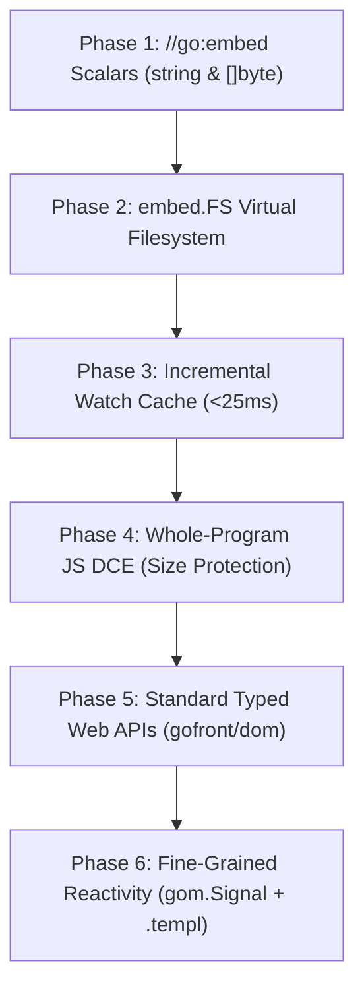

# v2.0.0 Web Platform Evolution — Design Plan

**Version:** v2.0.0  
**Status:** Draft  
**Related:** Builds on [`../v1.9.1/follow-ups-2026-11-10-plan.md`](../v1.9.1/follow-ups-2026-11-10-plan.md) and [`../v1.9.1/follow-ups-2026-11-11b-plan.md`](../v1.9.1/follow-ups-2026-11-11b-plan.md).  
**Release note:** GoFront v2.0.0 introduces compile-time asset embedding via `//go:embed`, sub-25ms incremental watch rebuilds, whole-program dead-code elimination on JS, first-class typed web APIs (`gofront/dom`, `gofront/canvas`, `gofront/fetch`), and fine-grained reactive DOM binding in `.templ` via `gom.Signal`.

---

## Goal

Transform GoFront from a Go-to-JS/WASM transpile pipeline into a complete, modern web application and reactive UI framework without compromising the pure Node.js ESM compiler architecture or violating the foundational **"No Runtime"** principle (no concurrency scheduler, no runtime reflection, no garbage-collected runtime threads).

v2.0.0 delivers five high-impact capabilities executed in strict dependency order:
1. **`//go:embed` asset and shader inlining:** Embed files directly into compiled bundles as `string`, `[]byte`, or `embed.FS` with zero runtime network fetch requests.
2. **Instant incremental compilation in `gofront dev`:** Sub-25ms file-save rebuilds for JS packages via package-level dependency caching and granular AST invalidation.
3. **Whole-program dead-code elimination (DCE):** Call-graph reachability analysis on user code to prune uncalled functions, unused struct methods, and uninstantiated types from JS bundles before codegen.
4. **Standard typed Web APIs:** Eliminate unchecked `any` across DOM, Canvas, and Fetch with canonical, type-checked Go packages under `stdlib/gofront/`.
5. **Fine-grained reactivity (`gom.Signal` + `.templ`):** Surgical, SolidJS-tier DOM text and attribute updates directly driven by signals in `.templ` templates—zero virtual DOM, zero diffing overhead.

**Done means:**
- `//go:embed` compiles assets into JS strings, `Uint8Array`s, and WASM WasmGC data segments across `js`, `wasm`, and `both` targets, verified by `test/unit/compiler/embed.test.js`.
- `embed.FS` provides `ReadFile` and `ReadDir` with glob matching across single and multi-file patterns (`test/unit/stdlib/embed.test.js`).
- `gofront dev` rebuilds a modified leaf file in a cached package in < 25ms on JS targets (`test/unit/cli/dev-server.test.js`).
- Unused user functions and unselected struct methods are completely omitted from emitted JS bundles, reducing example bundle sizes without regressions (`test/unit/compiler/dce.test.js`).
- DOM interactions compile with static type checking using `gofront/dom`, `gofront/canvas`, and `gofront/fetch` without manual type assertions from `any` (`test/unit/stdlib/web-apis.test.js`).
- Dynamic expressions in `.templ` bound to `gom.Signal` surgically update target DOM text and attribute nodes on `.Set()` calls without component remounting (`test/e2e/templ.spec.js` and `test/unit/builtins/gom.test.js`).
- All existing unit, E2E (`npm run test:e2e`), and zero-allocation performance benchmarks pass with zero regressions.

---

## Scope Rule & Boundary Matrix

| Category | Rule | Examples / Members | Reason (Excluded rows) |
|---|---|---|---|
| **In scope: core** | Asset embedding, incremental watch compilation, DCE, typed web APIs, and UI signals | `//go:embed`, `embed.FS`, `PackageCache`, reachability DCE, `gofront/dom`, `gom.Signal` | Core capabilities of the v2.0.0 web platform milestone |
| **In scope: target-specific** | Target-specific asset representation and reactivity | JS: UTF-8 string literals / `Uint8Array` / reactive subscriber closures. WASM: WasmGC passive data segments via `array.new_data` | Idiomatic platform and backend mapping |
| **Excluded: runtime / platform** | Concurrency scheduler, raw memory access, runtime reflection | Goroutines, channels, `select`, `unsafe.Pointer` to host memory, full `reflect` package | Strict adherence to the GoFront "No Runtime" architectural invariant |
| **Excluded: deferred** | Server-side rendering (SSR) hydration, multi-tab broadcast state, Web Worker RPC | `.templ` HTML stream hydration, `SharedWorker`, Web Worker message passing | Deferred to v2.1+; client-side signals, DOM reactivity, and compiler DX take precedence |

---

## Verified Gaps & Baseline Audit

| Area | Finding | Evidence & Probe Reference |
|---|---|---|
| Embed directive lexing | Lexer recognizes `//go:embed` comment prefix but discards file patterns | `src/lexer/lexer.js:211`: pushes only `{ line, col }` to `this.embedDirectives`; argument string is never captured |
| Embed typechecking | `//go:embed` is hard-coded as unsupported and package `embed` is excluded | `src/typechecker/index.js:455`: `this.err("//go:embed is not supported yet")`; `src/typechecker/stdlib/excluded.js:49`: `"embed"` in `EXCLUDED_STDLIB_PACKAGES` |
| WASM data section encoding | `src/backend/wasm/encode.js` has no support for Wasm Section 11 (Data) or Section 12 (DataCount) | `src/backend/wasm/encode.js:1010-1040`: `encodeModule` omits Data and DataCount sections entirely; WasmGC `[]byte` slice needs passive data segment + `array.new_data` |
| Watch rebuild latency | Dev server triggers a full cold compilation (`runCompile`) on every file modification | `src/cli/cli-core.js:1186`: `runDevBuild` re-executes `runCompile` from scratch; measured warm compile: `simple` = 336.6ms, `gom` = 239.8ms, `hybrid` = 628.8ms |
| AST cache invalidation | ASTs in `_parseCache` are mutated during typechecking and lowering, preventing cross-build reuse | `src/compiler.js:656`: `mangleLocalTypes` deletes ASTs from `_parseCache`; `plans/v1.9.1/follow-ups-2026-11-10-plan.md:109` confirms AST cloning was rejected |
| User-code DCE in JS | `src/lower/reachability.js` only prunes stdlib declarations; unused user functions and methods are fully emitted | `src/link/stdlib.js:422`: `reachableStdlibDecls` only filters `stdlibPrograms`; probe in `.probes/probe_dce`: `UnusedUserFunction` and `UnusedMethod` both emitted in `app.js` (168.4 kB) |
| Web APIs typing | Browser globals (`document`, `window`, `HTMLElement`, `fetch`) are typed as untyped dynamic `ANY` | `src/typechecker/stdlib/index.js:13`: `for (const g of BROWSER_GLOBALS) globals.define(g, ANY);` disables type safety on DOM operations |
| Templ reactivity | Templ codegen emits static one-time mounts with no update mechanism | `src/backend/js/templ.js:88-93, 160-180`: text expressions emit `document.createTextNode(String(expr))` and conditional attributes emit static `if (expr) setAttribute(...)` |

---

## Approach

### 1. Architecture & Design Decisions



#### Subsystem 1: `//go:embed` Asset Inlining (Phases 1 & 2)
- **Directive parsing:** In `src/lexer/lexer.js`, parse `//go:embed <pattern...>` comments into structured directive tokens `{ line, col, patterns: string[] }`. In `src/parser/declarations.js`, attach preceding embed directives to subsequent package-level `VarDecl` nodes.
- **Path resolution & security:** Resolve asset filepaths relative to the directory containing the source `.go` file. Reject paths that escape project boundaries (`..`), absolute paths, or paths pointing outside the workspace.
- **JS Codegen:**
  - `string`: Emit UTF-8 escaped string literal.
  - `[]byte`: Emit `new Uint8Array([...])` decoded buffer using base64 or byte literal encoding.
  - `embed.FS`: Emit a structured in-memory table mapping normalized paths to contents, backed by `stdlib/embed/embed.go`.
- **WASM Codegen:**
  - Add Section 11 (Data Section) and Section 12 (DataCount Section) to `src/backend/wasm/encode.js`.
  - For `[]byte` in WASM, store raw bytes into a passive data segment. Emit WasmGC `array.new_data $array_byte $data_idx` followed by slice header construction. This maintains WasmGC struct compatibility with zero linear-memory overhead.

#### Subsystem 2: Incremental Watch Compilation (Phase 3)
- **Dependency graph:** Construct a package-level DAG tracking direct and transitive package imports.
- **Cache architecture:** Introduce `PackageCache` in `src/compiler.js`. Each compilation unit caches:
  1. Parsed file ASTs with unmutated baseline shapes.
  2. Exported package symbol and type summaries.
  3. Emitted JS chunks for leaf and intermediate packages.
- **Granular invalidation:** In `src/cli/cli-core.js` and `src/cli/dev-server.js`:
  - When `file.go` changes, invalidate only its package and packages directly or indirectly importing it.
  - If a file modification does not alter exported types or signatures, dependent packages reuse their cached type summaries.
  - Watcher adds embedded asset files to the watch list so asset changes trigger rebuilds.

#### Subsystem 3: Whole-Program Dead-Code Elimination (Phase 4)
- **Reachability traversal:** Generalize `src/lower/reachability.js` beyond `stdlibPrograms` to user programs.
- **Roots:** Mark as roots:
  1. `main()` in the entry package.
  2. Functions exported across the WASM boundary (`//gofront:export` or boundary facade).
  3. `init()` functions and package-level variable initializers with side effects.
  4. Implicit runtime/formatter methods (`String()`, `Error()`, `MarshalJSON()`).
- **Pruning:** Prune unreached `FuncDecl`s, unreferenced struct types, and uncalled methods from the AST before JS codegen.
- **JS Class Methods:** For struct types that are retained, omit uncalled methods from the generated ES6 `class` definition and the `__vm` method array.

#### Subsystem 4: Standard Typed Web APIs (Phase 5)
- **Package location:** Add `stdlib/gofront/dom`, `stdlib/gofront/canvas`, `stdlib/gofront/fetch`, and `stdlib/gofront/websocket`.
- **Declaration mechanism:** Define typed Go interfaces and structs with `//gofront:target js`. Methods compile directly to native JS property accesses and method invocations without runtime wrapper overhead.
- **Backward compatibility:** Existing code using untyped `document` / `window` globals continues to type-check as `ANY`. Importing `gofront/dom` provides typed entry points (e.g., `dom.GetDocument()`, `dom.Window()`, typed element castings).
- **Callbacks:** Event listener functions take typed parameters (`func(e dom.MouseEvent)`).

#### Subsystem 5: Fine-Grained UI Reactivity (Phase 6)
- **Signals in `gom`:** Introduce `gom.Signal[T]` and `gom.Computed[T]` in `stdlib/gom/gom.go`:
  ```go
  count := gom.NewSignal(0)
  count.Set(count.Get() + 1)
  ```
- **Reactive binding in `.templ`:**
  - Enhance `src/backend/js/templ.js`: when an interpolation `{ sig.Get() }` or signal reference appears in a text node or attribute expression, emit a fine-grained subscriber effect:
    ```javascript
    const ___node = document.createTextNode("");
    sig.Subscribe(function(___v) { ___node.data = String(___v); });
    ___p.appendChild(___node);
    ```
  - For conditional attributes `class?={ sig.Get() }`, bind to `classList.toggle` inside the subscription closure.
  - Text and attributes update surgically on `.Set()` without remounting parent elements or running virtual DOM diffs.

---

### 2. Invariants & Safety Bounds

- **"No Runtime" Invariant:** No goroutines, channels, green-thread scheduler, or GC runtime shims. All reactivity is deterministic publisher-subscriber function closure dispatch in client JavaScript.
- **Dual Target Integrity:** `//go:embed` must function identically on `js`, `wasm`, and `both`. Web APIs and `.templ` reactivity remain strictly checked to `//gofront:target js`.
- **Cache Determinism:** Rebuilding incrementally via `gofront dev` must produce functionally identical output to a clean cold build. Any AST modification must not bleed across rebuild cycles.
- **Zero Runtime Dependencies:** The compiler remains 100% dependency-free pure Node.js ESM.

---

### 3. Edge Cases & Error Handling

- **Embed Path Traversal:** Reject `//go:embed ../secrets.env` or paths with `\` on Windows with `embed pattern escapes package directory`.
- **Unmatched Embed Patterns:** If an embed glob matches zero files, emit `pattern <pat> matches no files`.
- **Type Mismatch on Embed:** If `//go:embed` precedes a type other than `string`, `[]byte`, or `embed.FS`, report `cannot embed into variable of type <type>`.
- **Cycle in Watch Graph:** Circular package dependencies are rejected by the existing package resolver; the incremental DAG respects existing import validation.
- **DCE Interface Dispatch:** If an interface method is called dynamically (`var r io.Reader; r.Read(...)`), any concrete struct method matching that signature on an instantiated type must be marked reachable.
- **Signal Disconnect / Leaks:** When a component's parent element is removed, signal subscriptions attached during `Mount` must provide a cleanup callback mechanism if an unmount hook is called.

---

## Implementation Tasks

### Phase 1: `//go:embed` Scalar Inlining (`string` and `[]byte`)
- [ ] Task 1.1: Lex and parse `//go:embed` directives into AST var declarations
  - Files: `src/lexer/lexer.js`, `src/parser/declarations.js`, `src/parser/index.js`
  - Test: `test/unit/parser/embed-directives.test.js` asserting directive pattern extraction and AST attachment
  - Done when: `//go:embed "asset.txt"` attaches `{ patterns: ["asset.txt"], line, col }` to the succeeding `VarDecl`
- [ ] Task 1.2: Validate embed variable types and resolve secure relative asset paths
  - Files: `src/typechecker/index.js`, `src/resolver.js`
  - Test: `test/unit/typechecker/embed-check.test.js` asserting rejection of invalid types and path escapes (`..`)
  - Done when: Typechecker permits `string` and `[]byte` with valid local paths and errors on non-embeddable types or missing files
- [ ] Task 1.3: Emit embedded scalar assets in JS backend
  - Files: `src/backend/js/index.js`, `src/backend/js/declarations.js`
  - Test: `test/unit/compiler/embed-js.test.js` asserting string literals and `Uint8Array` byte data emitted in `app.js`
  - Done when: Embedded `string` and `[]byte` variables initialize correctly at package load without runtime network requests
- [ ] Task 1.4: Add Wasm Data and DataCount sections to Wasm encoder
  - Files: `src/backend/wasm/encode.js`, `src/backend/wasm/module-emitter.js`
  - Test: `test/unit/wasm/data-section.test.js` asserting Section 11 and Section 12 byte encoding and validation
  - Done when: `WebAssembly.validate` accepts encoded modules containing passive data segments
- [ ] Task 1.5: Emit embedded byte arrays via WasmGC `array.new_data` in WASM backend
  - Files: `src/backend/wasm/emit.js`, `src/backend/wasm/emit-exprs.js`
  - Test: `test/unit/compiler/embed-wasm.test.js` asserting embedded `[]byte` slice access in compiled WASM
  - Done when: A WASM package accessing an embedded `[]byte` correctly reads bytes with zero linear-memory copy

### Phase 2: `embed.FS` Virtual Filesystem Support
- [ ] Task 2.1: Implement `embed.FS` standard library package
  - Files: `stdlib/embed/embed.go`, `src/typechecker/stdlib/excluded.js`
  - Test: `test/unit/stdlib/embed-fs.test.js` asserting `ReadFile` and `ReadDir` on in-memory directory trees
  - Done when: `"embed"` is removed from `EXCLUDED_STDLIB_PACKAGES` and `embed.FS` compiles with `ReadFile` and `ReadDir`
- [ ] Task 2.2: Implement multi-file glob pattern resolution for `embed.FS`
  - Files: `src/resolver.js`, `src/compiler.js`
  - Test: `test/unit/compiler/embed-glob.test.js` asserting glob matching (`shaders/*.wgsl`, `assets/**/*`)
  - Done when: Globs match directories and files recursively, populating the virtual filesystem map
- [ ] Task 2.3: Codegen virtual filesystem manifest for JS and WASM
  - Files: `src/backend/js/declarations.js`, `src/backend/wasm/emit.js`
  - Test: `test/unit/compiler/embed-manifest.test.js` asserting FS lookup by path at runtime
  - Done when: `fs.ReadFile("shaders/light.wgsl")` returns file contents on both JS and WASM targets
- [ ] Task 2.4: Integrate embedded asset paths into dev-server watcher
  - Files: `src/cli/cli-core.js`, `src/cli/dev-server.js`
  - Test: `test/unit/cli/dev-server-embed.test.js` asserting that modifying an embedded asset file triggers dev reload
  - Done when: Editing `asset.txt` triggers an automatic rebuild in `gofront dev`

### Phase 3: Instant Incremental Compilation in `gofront dev`
- [ ] Task 3.1: Implement `PackageCache` and dependency DAG in compiler
  - Files: `src/compiler.js`, `src/cli/cli-core.js`
  - Test: `test/unit/compiler/package-cache.test.js` asserting DAG construction and cache hit/miss tracking
  - Done when: `PackageCache` stores compilation units and reports dirty status based on file mtime
- [ ] Task 3.2: Isolate AST mutation hazards during typechecking
  - Files: `src/typechecker/index.js`, `src/typechecker/resolve.js`
  - Test: `test/unit/compiler/ast-reusability.test.js` asserting that re-checking a cached package yields identical results
  - Done when: Cached ASTs can be safely re-used across successive compilation passes without mutation side effects
- [ ] Task 3.3: Implement incremental package-level rebuild in dev server
  - Files: `src/cli/cli-core.js`, `src/cli/dev-server.js`
  - Test: `test/unit/cli/incremental-build.test.js` asserting that single-file changes recompile only dirty dependents
  - Done when: Rebuilding `example/gom` or `example/simple` on a single-file edit completes in < 25ms
- [ ] Task 3.4: Preserve and verify source maps across incremental rebuild chunks
  - Files: `src/link/sourcemap.js`, `src/cli/cli-core.js`
  - Test: `test/unit/compiler/incremental-sourcemap.test.js` asserting valid source-map mappings after incremental updates
  - Done when: Browser DevTools correctly map source lines to original `.go` files after multiple incremental saves

### Phase 4: Whole-Program Dead-Code Elimination (DCE) on JS
- [ ] Task 4.1: Extend reachability analysis to user packages and call graphs
  - Files: `src/lower/reachability.js`, `src/lower/index.js`
  - Test: `test/unit/lower/reachability-user.test.js` asserting marking of reachability from `main` and exported roots
  - Done when: Call graph traces user function calls, variable initializers, and implicit methods
- [ ] Task 4.2: Prune unreferenced top-level functions and constants before JS codegen
  - Files: `src/lower/reachability.js`, `src/backend/js/index.js`
  - Test: `test/unit/compiler/dce-funcs.test.js` asserting uncalled user functions are omitted from output
  - Done when: An uncalled function in a user package does not appear in the emitted `app.js`
- [ ] Task 4.3: Prune uncalled struct methods and unreferenced struct classes
  - Files: `src/backend/js/index.js`, `src/backend/js/declarations.js`
  - Test: `test/unit/compiler/dce-methods.test.js` asserting unselected struct methods are omitted from ES6 classes
  - Done when: Methods never called or selected on a struct do not appear in its class body or `__vm` array
- [ ] Task 4.4: Add bundle size regression benchmark and conformance verification
  - Files: `test/unit/compiler/dce-bundle-size.test.js`, `test/perf/dce-bench.js`
  - Test: `test/unit/compiler/dce-bundle-size.test.js` asserting bundle size reduction on `example/simple` and `example/gom`
  - Done when: DCE achieves measurable size reduction across all standard examples with zero semantic regressions

### Phase 5: Standard Typed Web APIs (`gofront/dom`, `gofront/canvas`, `gofront/fetch`)
- [ ] Task 5.1: Implement typed DOM package under `stdlib/gofront/dom`
  - Files: `stdlib/gofront/dom/dom.go`, `src/resolver.js`
  - Test: `test/unit/stdlib/dom-typed.test.js` asserting type checking of `Document`, `Element`, `HTMLElement`, `Event`
  - Done when: `dom.GetDocument().GetElementById("app")` compiles with typed return values
- [ ] Task 5.2: Implement typed Canvas and 2D Context package under `stdlib/gofront/canvas`
  - Files: `stdlib/gofront/canvas/canvas.go`
  - Test: `test/unit/stdlib/canvas-typed.test.js` asserting `CanvasRenderingContext2D` methods compile without `any`
  - Done when: Canvas drawing commands (`FillRect`, `BeginPath`, `Arc`) type-check against strict Go signatures
- [ ] Task 5.3: Implement typed Fetch and HTTP request package under `stdlib/gofront/fetch`
  - Files: `stdlib/gofront/fetch/fetch.go`
  - Test: `test/unit/stdlib/fetch-typed.test.js` asserting `Request`, `Response`, `Headers`, and `fetch.Get` signatures
  - Done when: `fetch.Get(url)` returns a typed response struct with async promise completion
- [ ] Task 5.4: Implement typed WebSocket package under `stdlib/gofront/websocket`
  - Files: `stdlib/gofront/websocket/websocket.go`
  - Test: `test/unit/stdlib/websocket-typed.test.js` asserting event callback registration and sending typed payloads
  - Done when: `ws.OnMessage(func(e MessageEvent))` compiles and correctly receives typed event objects

### Phase 6: Fine-Grained Reactivity (`gom.Signal` + `.templ` Surgical Updates)
- [ ] Task 6.1: Implement `gom.Signal[T]` and `gom.Computed[T]` reactive primitives
  - Files: `stdlib/gom/gom.go`, `stdlib/gom/signals.go`
  - Test: `test/unit/stdlib/gom-signals.test.js` asserting `.Get()`, `.Set()`, `.Subscribe()`, and computed derivations
  - Done when: Updating a signal triggers registered subscriber callbacks synchronously
- [ ] Task 6.2: Add reactive expression analysis to `.templ` compiler
  - Files: `src/parser/templ.js`, `src/backend/js/templ.js`
  - Test: `test/unit/compiler/templ-reactive-detect.test.js` asserting identification of signal interpolation in templates
  - Done when: `{ sig.Get() }` and signal expressions in `.templ` are flagged as dynamic reactive nodes
- [ ] Task 6.3: Emit surgical text node subscriber bindings in `.templ`
  - Files: `src/backend/js/templ.js`
  - Test: `test/unit/compiler/templ-reactive-text.test.js` asserting text node `.data` assignment on signal `.Set()`
  - Done when: Dynamic template text updates surgically without parent DOM recreation
- [ ] Task 6.4: Emit surgical dynamic attribute and class toggle bindings
  - Files: `src/backend/js/templ.js`
  - Test: `test/unit/compiler/templ-reactive-attr.test.js` asserting attribute updates and `classList.toggle` on signal change
  - Done when: `class?={ sig.Get() }` toggles DOM classes surgically upon signal modification
- [ ] Task 6.5: Update documentation, guides, and example applications
  - Files: `docs/language-support.md`, `docs/compilation-mapping.md`, `README.md`, `example/gom/src/main.go`
  - Test: `npm run check && npm run test:e2e`
  - Done when: Documentation details `//go:embed`, typed web APIs, and `gom.Signal` usage, and all Playwright E2E tests pass cleanly
