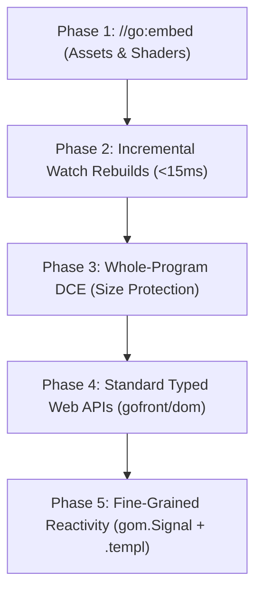

# v2.0.0 Web Platform Evolution — Design Plan Sketch

**Version:** v2.0.0  
**Status:** Draft (Concept Sketch — to be audited via `/design-plan`)  
**Base branch:** `main` (after v1.9.1 release)  
**Related:** Supersedes the shelved native Go rewrite in [`native-go-engine.md`](native-go-engine.md); builds on [`../v1.9.1/follow-ups-2026-11-10-plan.md`](../v1.9.1/follow-ups-2026-11-10-plan.md).  
**Release note:** GoFront v2.0.0 elevates the developer experience with compile-time asset embedding via `//go:embed`, sub-15ms incremental watch rebuilds, whole-program dead-code elimination, first-class typed web APIs (`gofront/dom`, `gofront/canvas`), and fine-grained reactive UI components using `gom` signals in `.templ`.

---

## Goal

Transform GoFront from a *"Go-to-JS/WASM compiler"* into a complete, modern **web application and reactive UI framework** without sacrificing the pure Node.js ESM compiler architecture or violating the foundational **"No Runtime"** principle.

Instead of spending cycles porting the compiler engine to native Go (which would yield zero user-facing capabilities), v2.0.0 delivers 5 high-impact features executed in dependency order:

1. **`//go:embed` asset and shader inlining:** Embed shaders, SVGs, configs, and HTML directly into compiled bundles as `string`, `[]byte`, or `embed.FS` with zero runtime network overhead.
2. **Instant incremental compilation in `gofront dev`:** Sub-15ms file-save rebuilds via dependency graph caching and immutable AST reuse.
3. **Whole-program dead-code elimination (DCE):** Reachability call-graph analysis to prune unreferenced functions, struct methods, and monomorphized types from bundles before codegen.
4. **Standard typed Web APIs:** Eliminate `any` across the DOM, Canvas, and Fetch by shipping auto-generated, type-checked Go packages under `stdlib/gofront/`.
5. **Fine-grained reactivity (`gom.Signal` + `.templ`):** SolidJS/Svelte-tier surgical DOM updates with strict Go type safety—zero virtual DOM, zero diffing overhead.

**Done means:**
- `//go:embed` compiles assets into JS strings/Uint8Arrays and WASM data sections across `js`, `wasm`, and `both` targets with zero runtime network requests.
- `gofront dev` rebuilds unchanged package dependencies in under 15ms on file modifications.
- Unused methods and functions are pruned from emitted JS and WASM binaries, proven by bundle size metrics.
- Browser interactions compile with static type safety using `gofront/dom`, `gofront/canvas`, and `gofront/fetch` without requiring explicit casts from `any`.
- Dynamic expressions in `.templ` bound to `gom.Signal` surgically update target DOM text and attribute nodes without component re-mounting.
- All unit, E2E, and zero-allocation performance benchmarks pass without regression.

---

## Scope Rule & Boundary Matrix

| Category | Rule | Examples / Members | Reason (Excluded rows) |
|---|---|---|---|
| **In scope: core** | Asset embedding, incremental compilation, DCE, Web APIs, and UI reactivity | `//go:embed`, `embed.FS`, incremental watch cache, call-graph reachability, `gofront/dom`, `gom.Signal` | Focus of v2.0.0 evolution |
| **In scope: target-specific** | Target-specific asset representations & reactivity | JS: UTF-8 strings/TypedArrays, signal subscriber functions. WASM: data segment slices, typed boundary views. | Native platform mapping |
| **Excluded: runtime / platform** | Concurrency scheduler, raw memory access, and runtime reflection | Goroutines, channels, `select`, `unsafe`, full `reflect` package | Strict adherence to the "No Runtime" architectural invariant |
| **Excluded: engine** | Native Go compiler rewrite | Shelved `plans/v2.0.0/native-go-engine.md` | Retains pure Node.js ESM compiler architecture |
| **Excluded: deferred** | Server-side rendering (SSR) hydration, multi-tab broadcast state | `.templ` HTML stream hydration, Web Worker RPC | Deferred to v2.1+; signals and DOM updates come first |

---

## Architectural Approach & Sequencing

The execution sequence is ordered strictly by dependency, safety, and return on investment:



---

### Phase 1: `//go:embed` Asset & Shader Inlining
*Self-contained, high utility, zero coupling to later phases.*

- **Syntax & Semantics:**
  - Standard Go `//go:embed <pattern>` directive placed immediately above package-level `string`, `[]byte`, or `embed.FS` variables.
  - Multi-file globs (`*.wgsl`, `shaders/*`) supported via `embed.FS`.
- **Implementation Subsystems:**
  - `src/lexer/`: Recognize `//go:embed` directive tokens and attach metadata to the succeeding `VarDecl`.
  - `src/resolver.js`: Resolve relative filesystem paths securely within project bounds.
  - `src/backend/js/`: Emit string literals (with escaping) or `new Uint8Array([...])` decoded buffers.
  - `src/backend/wasm/`: Emit embedded byte arrays directly into active WASM data segments with pointer/length slice access (zero copy).
- **Target Test Fixture:** SimpleFPS shader loading without runtime fetch.

---

### Phase 2: Instant Incremental Compilation in `gofront dev`
*Leverages 1.9.1 immutable AST cache; dramatically accelerates DX and test loops.*

- **Design:**
  - Package-level dependency DAG with mtime tracking.
  - Only re-parse and re-typecheck files modified since the last compilation and their direct dependent packages.
  - Leverage 1.9.1 Phase 1's immutable AST cache (`H01`) to eliminate in-place mutation hazards across rebuild passes.
- **Implementation Subsystems:**
  - `src/compiler.js`: Add cached package compilation units (`PackageCache`).
  - `src/cli/dev-server.js`: Track file watcher events and trigger incremental compilation passes.
- **Metric:** Rebuild latency < 15ms on single-file save for projects the size of `example/hybrid` and SimpleFPS.

---

### Phase 3: Whole-Program Tree-Shaking & Dead Code Elimination (DCE)
*Must land BEFORE introducing extensive web API packages to prevent bundle bloat.*

- **Design:**
  - Build a static symbol call graph starting from entry roots:
    - `main()` entry point.
    - Exported WebAssembly functions / boundary methods.
    - Exported JS package declarations.
    - Active `.templ` component trees.
  - Traverse reachability in `src/lower/reachability.js`.
  - Prune unreached function declarations, unused struct methods, and uninstantiated generic types before codegen.
- **WASM Payoff:** Strips uncalled monomorphized generic variants and dead interface dispatcher tables, shrinking `app.wasm`.

---

### Phase 4: Standard Typed Web APIs (`gofront/dom`, `gofront/canvas`, `gofront/fetch`)
*Eliminates `any` across frontend code; safe from bundle bloat thanks to Phase 3 DCE.*

- **Design:**
  - Leverage `src/dts-parser.js` to parse standard `@types/web` definitions into canonical Go packages under `stdlib/gofront/`:
    - `gofront/dom`: `HTMLElement`, `HTMLInputElement`, `Event`, `MouseEvent`, `Document`, `Window`.
    - `gofront/canvas`: `CanvasRenderingContext2D`, `ImageData`, `Path2D`.
    - `gofront/fetch`: `Request`, `Response`, `Headers`, `AbortController`.
    - `gofront/websocket`: `WebSocket`, `MessageEvent`.
  - Map DOM event callbacks to typed Go function signatures.
  - Phase 3's DCE ensures that importing `gofront/dom` pulls in only the exact methods called, keeping bundle sizes minimal.

---

### Phase 5: Fine-Grained Reactive UI (`gom.Signal` + `.templ` Surgical Updates)
*The crowning feature of v2.0.0: Modern reactive UI with Go type safety.*

- **Design:**
  - Introduce `gom.Signal[T]` and `gom.Computed[T]` in `stdlib/gom/`:
    ```go
    count := gom.NewSignal(0)
    count.Set(count.Get() + 1)
    ```
  - Enhance `.templ` compiler (`src/backend/js/templ.js`):
    - When an interpolated expression `{ signal.Get() }` is encountered in a text node or attribute position, emit a fine-grained subscriber rather than a static one-time render:
      ```javascript
      const node = document.createTextNode("");
      signal.subscribe(val => { node.data = val; });
      ```
    - Attribute bindings: `class?={ signal.Get() }` binds directly to `classList.toggle` on signal change.
- **Result:** SolidJS / Svelte 5 level surgical DOM reactivity without virtual DOM overhead, Virtual DOM diffing, or component re-renders.

---

## Next Steps for `/design-plan` Audit

When ready to formalize this into an executable plan:
1. Complete and merge the 6 phases of [`follow-ups-2026-11-10-plan.md`](../v1.9.1/follow-ups-2026-11-10-plan.md) for the v1.9.1 patch release.
2. Run `/design-plan` against this sketch to conduct an empirical baseline audit and generate detailed tasks with `Files:`, `Test:`, and `Done when:` criteria per phase.
